# Мониторинг популяции диких животных

## 1. Название проекта

**Wildlife Monitoring DB** — база данных для мониторинга популяции диких животных.

## 2. Краткое описание идеи проекта

Приложение предназначено для сбора, хранения и анализа данных о популяции диких животных в разных природных зонах. Оно позволяет фиксировать наблюдения за животными, учитывать места обитания и отслеживать изменения численности популяций во времени. Система будет полезна для исследователей и сотрудников природоохранных организаций, которым важно получать структурированные и актуальные данные.

## 3. Краткое описание предметной области

Предметная область — экологический мониторинг и учет популяции диких животных. Основные сущности предметной области: Животные или виды животных (Animals / Species), Наблюдения (Observations), Локации наблюдения (Locations), Исследователи (Researchers), а также Учеты численности (PopulationRecords). Система позволяет сохранять сведения о том, какие животные были замечены, где и когда это произошло, кем было выполнено наблюдение, а также анализировать динамику популяции по территориям и временным периодам.

## 4. Краткий анализ аналогичных решений


| Критерий                                 | Wildlife Insights                               | SMART Conservation Software                                    | Самописные таблицы / Excel                                      |
| ---------------------------------------- | ----------------------------------------------- | -------------------------------------------------------------- | --------------------------------------------------------------- |
| Структурированность и целостность данных | Высокая, данные организованы в рамках платформы | Высокая, поддерживается формализованная структура              | Низкая, высок риск дублей, пропусков и несогласованности данных |
| Гибкость настройки под локальные задачи  | Ограничена возможностями платформы              | Средняя, настройка возможна, но зависит от архитектуры системы | Формально высокая, но без контроля связей и ограничений         |
| Удобство анализа динамики популяции      | Высокое, доступны исследовательские инструменты | Высокое, возможно формирование отчетности и аналитики          | Низкое, анализ требует ручной обработки                         |
| Контроль качества вводимых данных        | Высокий, за счет правил платформы               | Высокий, благодаря централизованному управлению                | Низкий, ошибки ввода сложно предотвращать                       |


## 5. Краткое обоснование целесообразности и актуальности проекта

Мониторинг диких животных важен для оценки состояния экосистем, выявления угроз для отдельных видов и планирования природоохранных мероприятий. На практике данные часто собираются разрозненно, что затрудняет их анализ, сопоставление и долгосрочное хранение. Разработка специализированной базы данных позволит централизовать информацию о наблюдениях и популяциях, упростить работу исследователей и повысить качество экологического учета.

## 6. Краткое описание акторов (ролей)

- **Исследователь** – пользователь, который фиксирует наблюдения за животными, вносит информацию о месте, времени и результатах учета. Может просматривать историю собственных наблюдений и аналитические данные.
- **Администратор** – пользователь, который управляет справочниками видов и локаций, контролирует корректность данных, а также имеет доступ ко всем наблюдениям и отчетам в системе.


## 7. Use-Case диаграмма

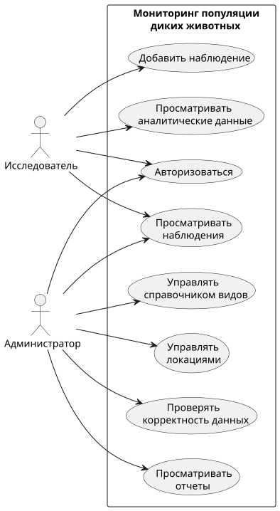

## 8. ER-диаграмма сущностей

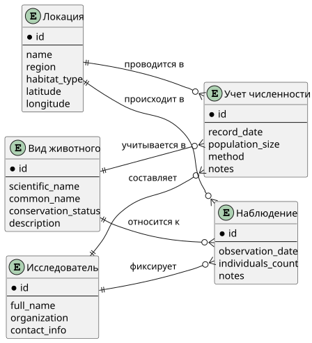

## 9. Пользовательские сценарии


### Сценарий 1 (актор: Исследователь)

1. Исследователь авторизуется в системе.
2. Переходит в раздел добавления нового наблюдения.
3. Выбирает вид животного, указывает локацию и дату наблюдения.
4. Вводит количество замеченных особей и дополнительные заметки.
5. Система сохраняет наблюдение в базе данных.


### Сценарий 2 (актор: Исследователь)

1. Исследователь открывает раздел статистики.
2. Выбирает интересующий вид животного.
3. Указывает временной диапазон и территорию наблюдения.
4. Система формирует выборку по сохраненным наблюдениям.
5. Исследователь получает данные о динамике численности популяции.


### Сценарий 3 (актор: Администратор)

1. Администратор авторизуется в системе.
2. Переходит в раздел управления справочником видов.
3. Добавляет новый вид животного или редактирует существующую запись.
4. При необходимости корректирует список локаций наблюдения.
5. Система обновляет справочные данные, которые затем доступны исследователям.


## 10. Формализация ключевых бизнес-процессов


### 10.1 Управление справочником видов

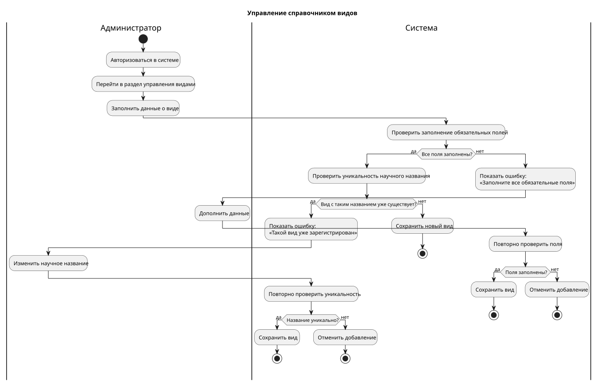

### 10.2 Фиксация учетных данных о популяции

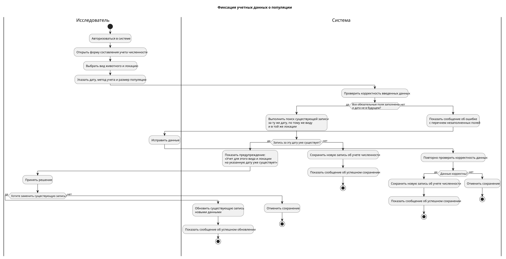

### 10.3 Анализ динамики популяции

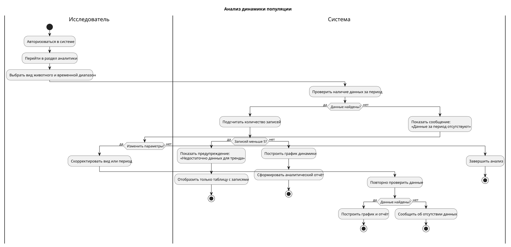

---


# Лабораторная работа №2 — UML и C4


## 11. Тип приложения и технологический стек


| Параметр                        | Выбор                                                                    |
| ------------------------------- | ------------------------------------------------------------------------ |
| Тип с точки зрения пользователя | **Web MPA** — многостраничное веб-приложение (формы и отчёты в браузере) |
| Язык                            | **Python 3.12**                                                          |
| UI (план)                       | **Flask** + **Jinja2** (MVC)                                             |
| Доступ к данным (план)          | **SQLAlchemy**, паттерн **Repository**                                   |
| СУБД                            | **PostgreSQL**                                                           |
| Принципы                        | Слои UI / сервисы / данные; **DIP** — сервисы зависят от `IRepository`   |


Уровень L4 на лаб. №2 раскрыт **диаграммами UML** (п. 15), без реализации слоя данных и UI.

Схема БД: [database/schema.dbml](./database/schema.dbml).

## 12. C4 — уровень L1 (контекст)

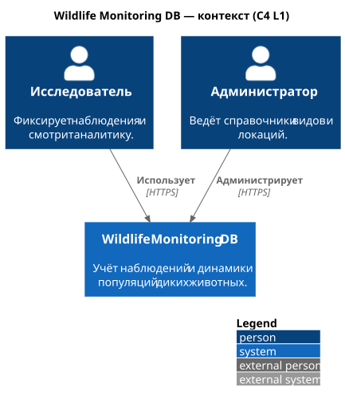

Исходник: [diagrams/lab2/c4/L1-context.puml](./diagrams/lab2/c4/L1-context.puml)

## 13. C4 — уровень L2 (контейнеры)

Для веб-приложения выделены три контейнера: **Web UI**, **Backend API**, **PostgreSQL**.

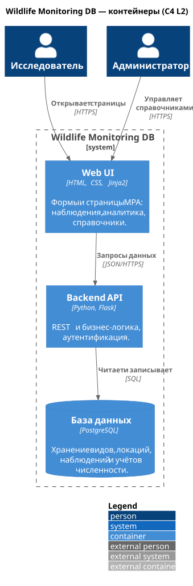

Исходник: [diagrams/lab2/c4/L2-container.puml](./diagrams/lab2/c4/L2-container.puml)

## 14. C4 — уровень L3 (компоненты)

Внутри Backend API: контроллеры (UI-слой API), сервисы (бизнес-логика), репозитории (доступ к данным). Web UI обращается только к API, не к БД напрямую.

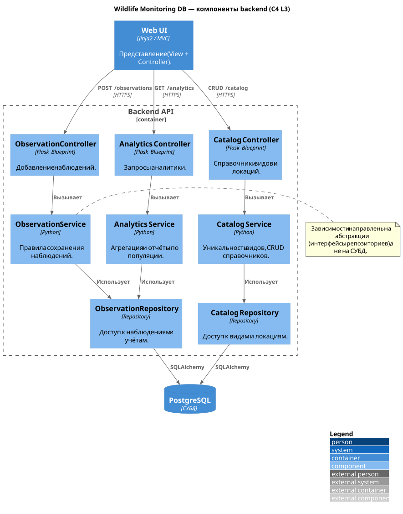

Исходник: [diagrams/lab2/c4/L3-component.puml](./diagrams/lab2/c4/L3-component.puml)

## 15. C4 — уровень L4 (UML диаграммы классов)


### 15.1 Компонент доступа к данным

ORM-модели, доменные сущности, интерфейс `IRepository` и `PostgresRepository`.

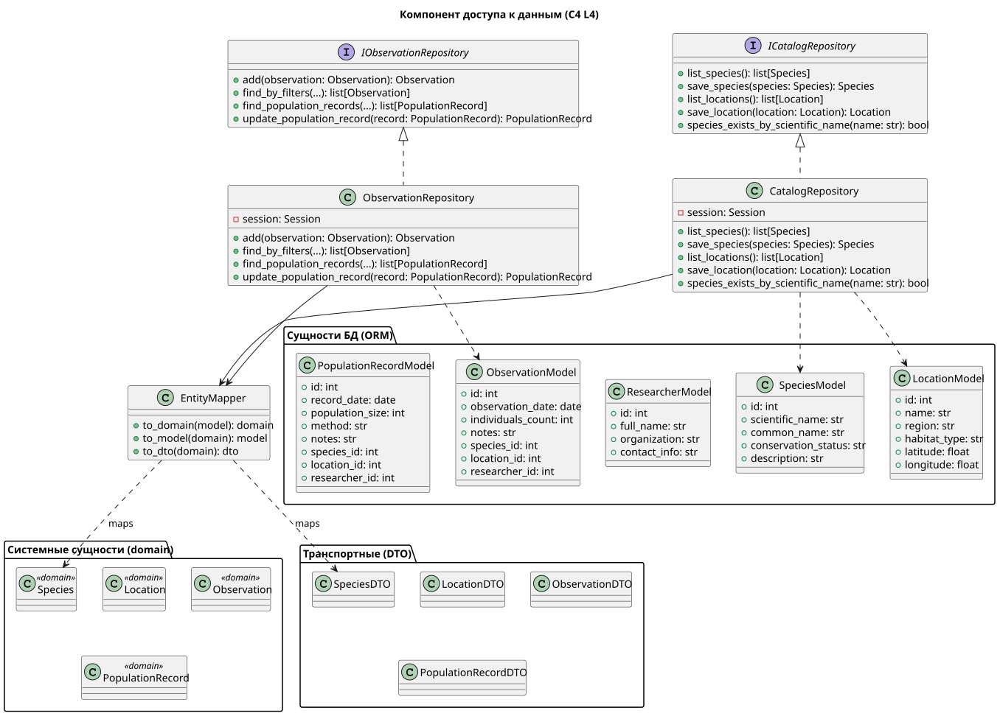

Исходник: [diagrams/lab2/uml/class-data-layer.puml](./diagrams/lab2/uml/class-data-layer.puml)

### 15.2 Компонент бизнес-логики

Сервисы работают с DTO и доменными объектами; зависят от абстракции `IRepository` (DIP). Черновик на момент лаб. №2:

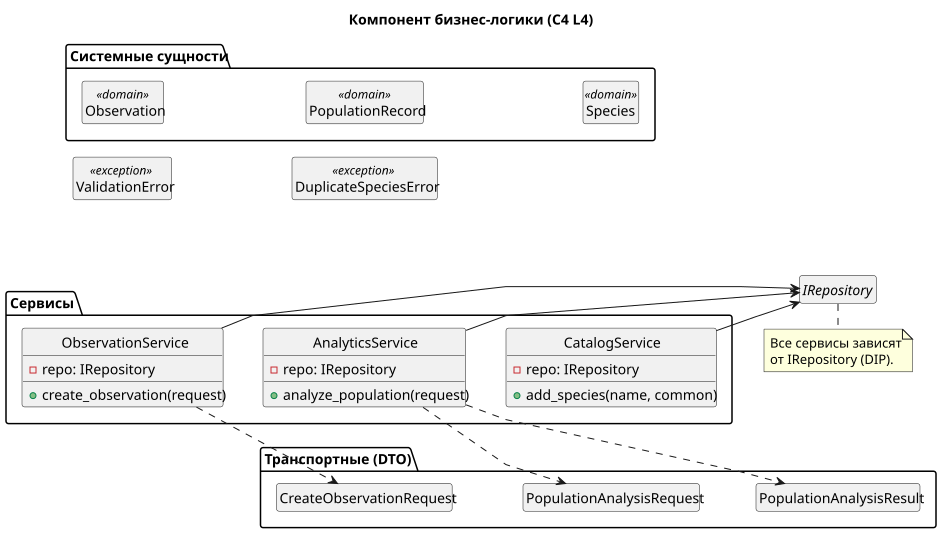

Исходник: [diagrams/lab2/uml/class-business-layer.puml](./diagrams/lab2/uml/class-business-layer.puml)

## 16. UML — диаграммы последовательностей (по BPMN из п. 10)


| BPMN (п. 10)                   | Диаграмма последовательности                                                     |
| ------------------------------ | -------------------------------------------------------------------------------- |
| 10.1 Добавление наблюдения     | [seq-add-observation.puml](./diagrams/lab2/uml/seq-add-observation.puml)         |
| 10.2 Анализ динамики популяции | [seq-population-analysis.puml](./diagrams/lab2/uml/seq-population-analysis.puml) |
| 10.3 Управление справочниками  | [seq-catalog-manage.puml](./diagrams/lab2/uml/seq-catalog-manage.puml)           |


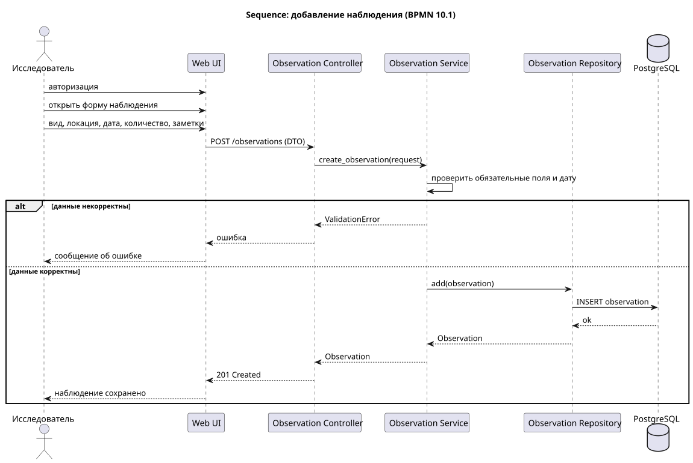

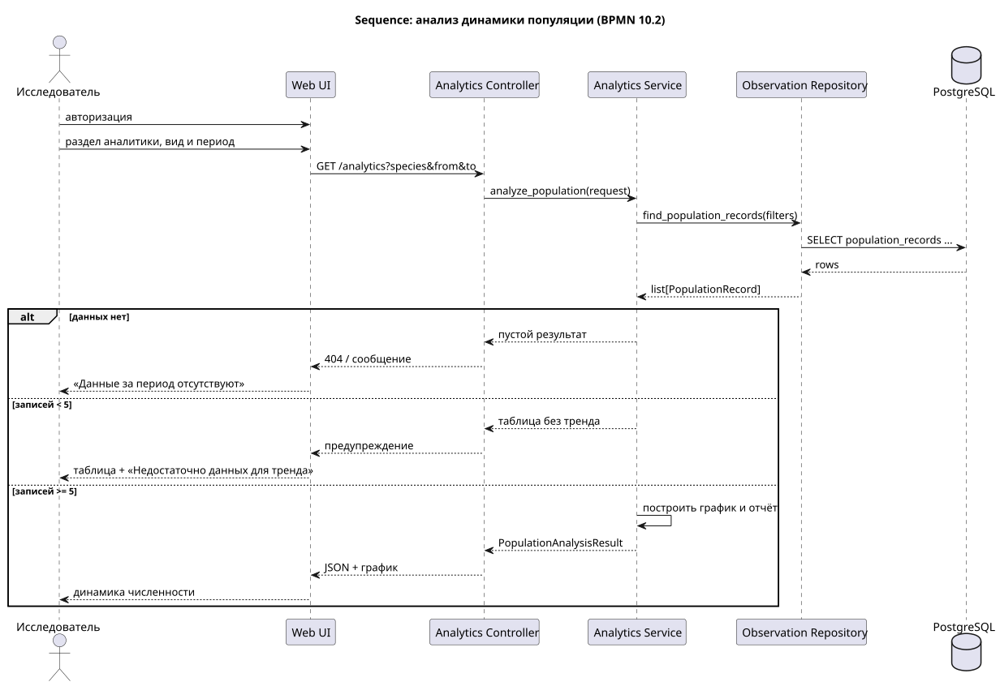

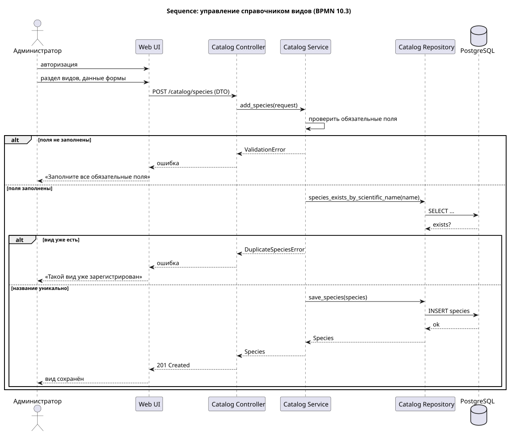

## 17. Схема базы данных (DBML, PostgreSQL)

Исходник: [database/schema.dbml](./database/schema.dbml)

Таблицы: `species`, `locations`, `researchers`, `observations`, `population_records` (связи — как в ER, п. 8). Уникальный ключ учёта численности: вид + локация + дата.

---


# Лабораторная работа №3 — бизнес-логика и тесты


## 18. Компонент бизнес-логики (реализация)

Код только для слоя бизнес-логики — каталог `[src/business/](src/business/)`:


| Модуль                   | Публичный API                                             |
| ------------------------ | --------------------------------------------------------- |
| `observation_service.py` | `create_observation(request)`                             |
| `analytics_service.py`   | `analyze_population(request)`                             |
| `catalog_service.py`     | `add_species(request)`                                    |
| `exceptions.py`          | `ValidationError`, `DuplicateSpeciesError`, `NoDataError` |


Вспомогательно для сервисов: `[src/entities.py](src/entities.py)`, `[src/dto.py](src/dto.py)`, интерфейс `[IRepository](src/repository.py)` (реализация — лаб. №4).

Сервисы зависят от `IRepository` (DIP). Правила по BPMN из п. 10.

Запуск тестов (классические + лондонские, без реальной БД):

```bash
pip install -r requirements.txt
py -m pytest
```

Локальный HTML-отчёт покрытия: `htmlcov/index.html`.

Отчёт Allure (шаги, эпики, классическая и лондонская школы):

```powershell
.\scripts\allure-report.bat
```

`py -m pytest` сам пишет сырые результаты в `allure-results/`. Скрипт собирает HTML в `allure-report/` и открывает его. Для HTML нужны Java 17+ и Allure CLI: если CLI нет в PATH, скрипт скачивает Allure 2.46.1 в `tools/`.

UI SonarQube (Coverage на дашборде проекта):

```powershell
.\scripts\sonar-coverage.bat
```

Если PowerShell ругается на execution policy, то же самое так:

```powershell
powershell -ExecutionPolicy Bypass -File .\scripts\sonar-coverage.ps1
```

После загрузки: http://localhost:9000/dashboard?id=wildlife-monitoring


## 19. C4 L4 — обновлённая диаграмма бизнес-логики (лаб. №3)

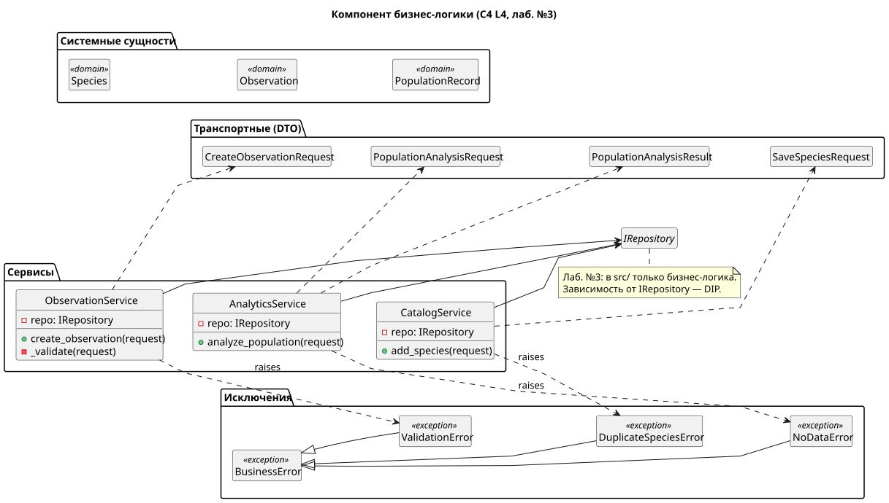

Исходник: [diagrams/lab3/uml/class-business-layer.puml](./diagrams/lab3/uml/class-business-layer.puml)

Пересборка SVG: `.\diagrams\render-lab3.ps1`

---


# Лабораторная работа №4 — доступ к данным


## 20. Компонент доступа к данным (реализация)

Код слоя данных — каталог `[src/repositories/](src/repositories/)`:


| Модуль                 | Назначение                                                                                                          |
| ---------------------- | ------------------------------------------------------------------------------------------------------------------- |
| `sqlite_repository.py` | `SqliteRepository` — SQL без ORM, файл SQLite                                                                       |
| `schema.py`            | DDL таблиц по [database/schema.dbml](database/schema.dbml)                                                          |
| `exceptions.py`        | `DataAccessError`, `DataValidationError`, `EntityNotFoundError`, `DuplicateEntityError`, `IntegrityConstraintError` |


Контракт задаёт бизнес-логика: `[IRepository](src/repository.py)` и доменные сущности `[src/entities.py](src/entities.py)`. Репозиторий **реализует** этот интерфейс (DIP): слой данных зависит от бизнес-слоя, а не наоборот. Конкретная СУБД за интерфейсом не видна — `SqliteRepository` можно заменить другой реализацией.

CRUD видов: `save_species`, `get_species`, `update_species`, `delete_species`. Также реализованы `add_observation`, `find_population_records`, `species_exists`.

Запуск тестов:

```bash
pip install -r requirements.txt
py -m pytest
```


## 21. C4 L4 — обновлённая диаграмма доступа к данным (лаб. №4)

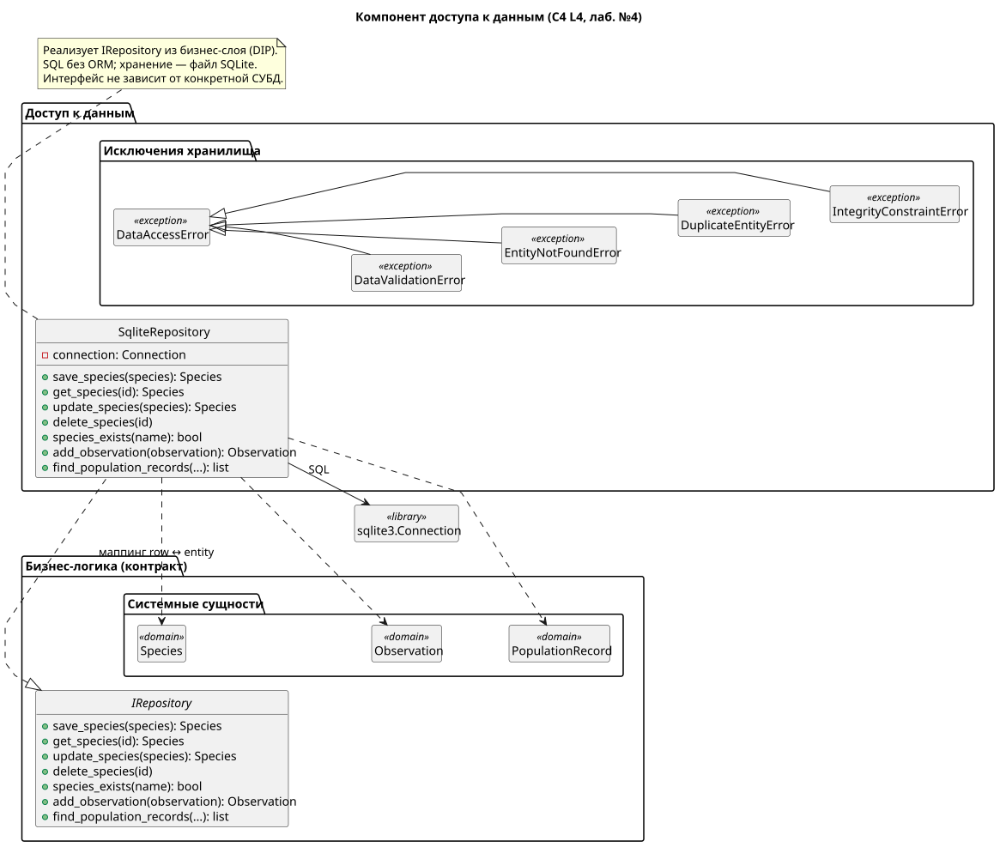

Исходник: [diagrams/lab4/uml/class-data-layer.puml](diagrams/lab4/uml/class-data-layer.puml)

Пересборка SVG: `.\diagrams\render-lab4.ps1`

---


# Лабораторная работа №5 — технологический UI


## 22. Технологический UI (реализация)

Консоль в `[src/wildlife_ui/](src/wildlife_ui/)` вызывает **те же сервисы**, что будет использовать будущий GUI (`ObservationService`, `CatalogService`, `AnalyticsService`). До SQLite UI не обращается: конкретный репозиторий собирается только в `[src/wildlife_app/main.py](src/wildlife_app/main.py)`.


| Модуль                       | Назначение                                          |
| ---------------------------- | --------------------------------------------------- |
| `wildlife_ui/console_app.py` | Меню ролей и сценарии из ТЗ                         |
| `wildlife_ui/io.py`          | `IUserIO` / `ConsoleIO` — ввод-вывод за интерфейсом |
| `wildlife_app/main.py`       | Composition root: SQLite + сервисы + консоль        |


Покрытие use case: выбор роли (авторизация-заглушка), добавить/смотреть наблюдения, аналитика популяции, справочник видов (добавить/изменить), локации, исследователи. Ошибки валидации показываются на экране.

Запуск:

```bash
py -m wildlife_app
```

Файл БД по умолчанию: `wildlife.db` (можно передать путь первым аргументом).

Классические тесты длинного сценария:

```bash
py -m pytest -m classical
```


## 23. C4 L2 и L3 (обновление, лаб. №5)

Вместо запланированного Web UI на этом этапе — консольный технологический UI.

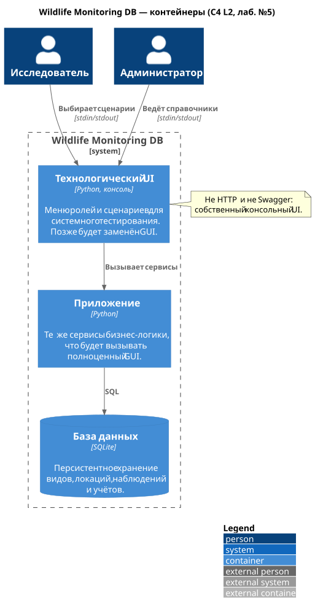

Исходник: [diagrams/lab5/c4/L2-container.puml](diagrams/lab5/c4/L2-container.puml)

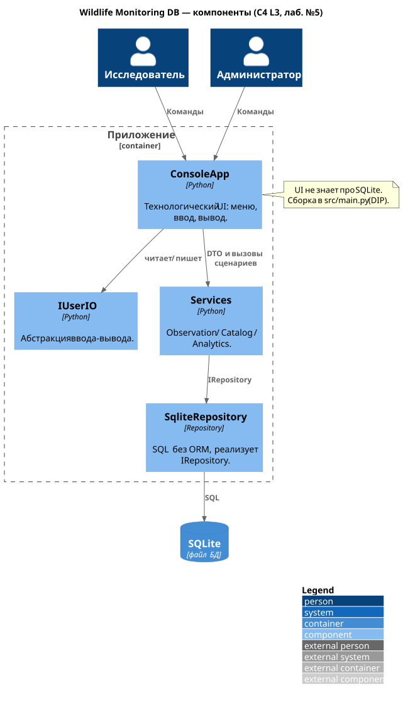

Исходник: [diagrams/lab5/c4/L3-component.puml](diagrams/lab5/c4/L3-component.puml)

## 24. C4 L4 — диаграмма технологического UI

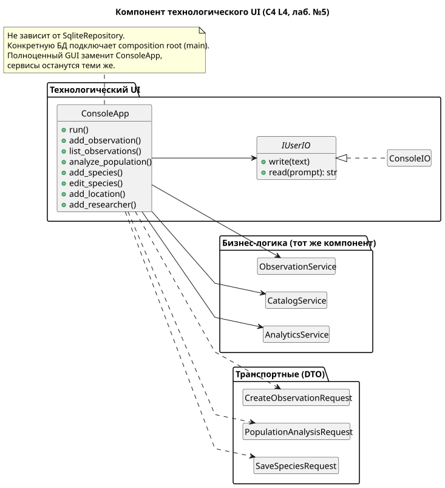

Исходник: [diagrams/lab5/uml/class-ui-layer.puml](diagrams/lab5/uml/class-ui-layer.puml)

Пересборка SVG: `.\diagrams\render-lab5.ps1`

---


# Лабораторная работа №6 — сборка, логирование, конфигурирование


## 25. Сборка компонентов

Каждый компонент — отдельная единица развёртывания:


| Сборка              | Исходники                                          | Назначение                                         |
| ------------------- | -------------------------------------------------- | -------------------------------------------------- |
| `wildlife-business` | `[src/wildlife_business/](src/wildlife_business/)` | Сервисы, `IRepository`, сущности, DTO              |
| `wildlife-data`     | `[src/wildlife_data/](src/wildlife_data/)`         | `SqliteRepository`, SQL без ORM                    |
| `wildlife-ui`       | `[src/wildlife_ui/](src/wildlife_ui/)`             | Технологический UI                                 |
| `wildlife-app`      | `[src/wildlife_app/](src/wildlife_app/)`           | Связывает три компонента, читает конфиг, пишет лог |


Описания сборок: `[components/](components/)`. Готовые файлы: `[assembled/](assembled/)`.

Собрать заново:

```bash
.\scripts\build_components.ps1
```


## 26. Конфигурация и логирование

Файл `[config.ini](config.ini)`:

- `database.connection_string` — строка подключения к SQLite
- `business.min_records_for_trend` — порог записей для тренда (бизнес-логика)
- `logging.level` / `logging.file` — уровень и файл лога

В лог пишутся действия пользователя (INFO) и все исключения (WARNING/ERROR с трассировкой): `logs/app.log`.

## 27. Запуск не из IDE

Двойной щелчок или из проводника/терминала:

```text
run.bat
```

Либо из папки собранных компонентов (ставится venv и колёса):

```text
assembled\run.bat
```


## 28. C4 L1–L4 (уточнение на всё приложение)

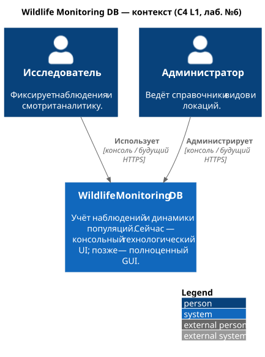

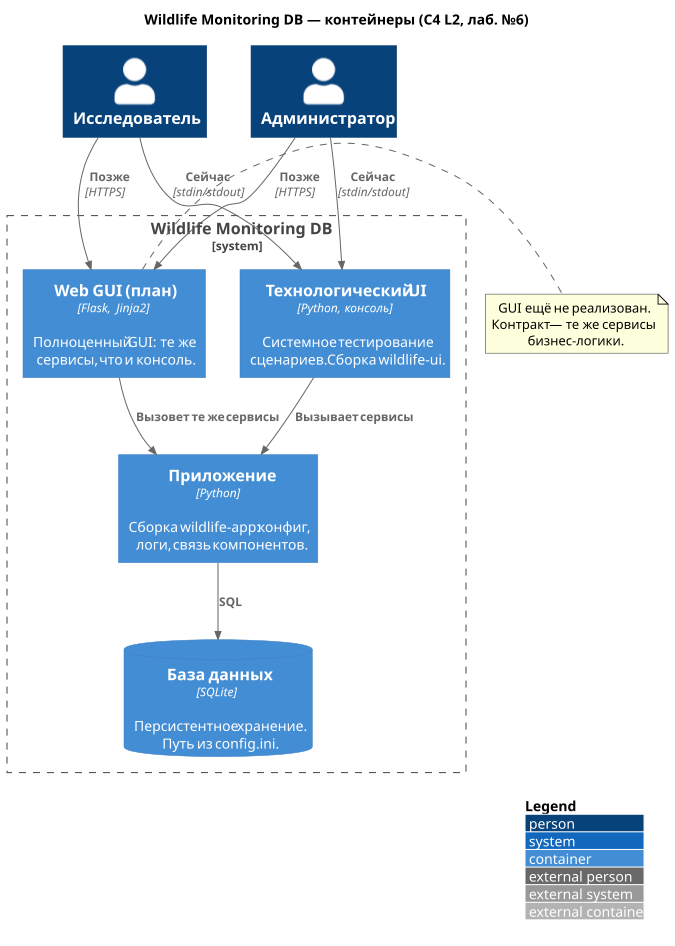

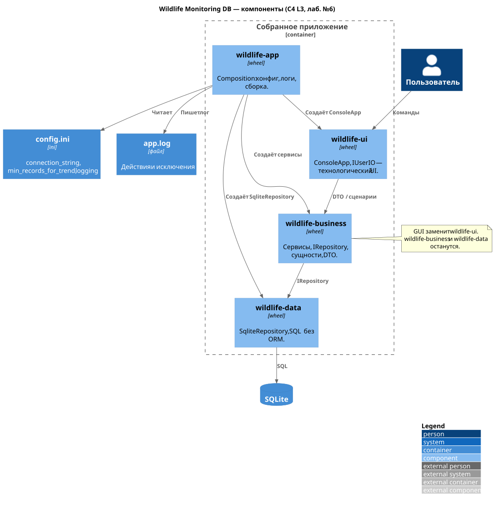

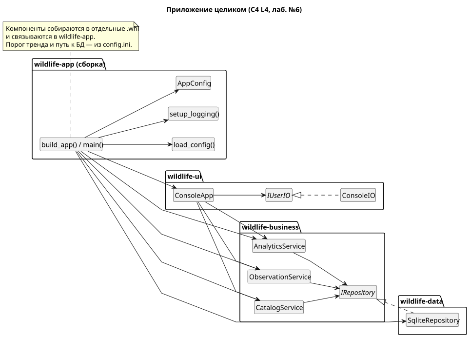

Исходники: [diagrams/lab6/c4/](diagrams/lab6/c4/), [diagrams/lab6/uml/class-application.puml](diagrams/lab6/uml/class-application.puml).

Пересборка: `.\diagrams\render-lab6.ps1`

## 29. Собранные компоненты (файлы сборок)

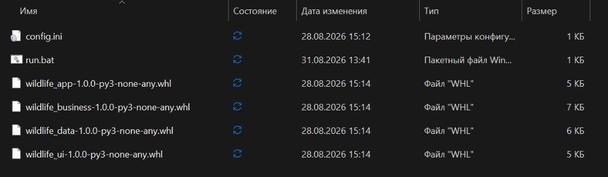

Папка: `[assembled/](assembled/)` — `.whl` компонентов, `config.ini`, `run.bat`.

---


# Лабораторная работа №7 — графический UI (MVC)


## 30. Компонент графического интерфейса

GUI — каталог `[src/wildlife_gui/](src/wildlife_gui/)`, сборка `wildlife-gui`. Паттерн **MVC**:


| Слой             | Код                                                              | Назначение                                            |
| ---------------- | ---------------------------------------------------------------- | ----------------------------------------------------- |
| Model            | сервисы `wildlife_business` и DTO                                | Те же сценарии, что и у консоли                       |
| Controller       | `[controllers.py](src/wildlife_gui/controllers.py)`              | Роли, viewmodel, обработка ошибок домена              |
| View             | шаблоны Jinja2 и `[flask_app.py](src/wildlife_gui/flask_app.py)` | HTTP: маршруты Flask, сессия роли, отрисовка          |
| Связь с бизнесом | `[forms.py](src/wildlife_gui/forms.py)`                          | Формы GUI → DTO; GUI не зависит от `SqliteRepository` |


Экраны разнесены: выбор роли; у исследователя — список наблюдений, добавление, аналитика; у администратора — виды, локации, исследователи. Текущие роль и раздел всегда видны в шапке, результат операции — сообщением на экране.

Технологический UI сохранён: `py -m wildlife_app` или `--ui console`. Графический UI:

```bash
py -m wildlife_app --ui gui
```

Либо `run-gui.bat`. Адрес по умолчанию: http://127.0.0.1:5000 (секция `[gui]` в `[config.ini](config.ini)`).

Пересборка колёс: `.\scripts\build_components.ps1` — в `[assembled/](assembled/)` появляется `wildlife_gui-*.whl`. Запуск GUI из сборок: `assembled\run-gui.bat`.

Лондонские тесты взаимодействий:

```bash
py -m pytest -m london
```

## 31. C4 L1–L3 (обновление) и L4 GUI

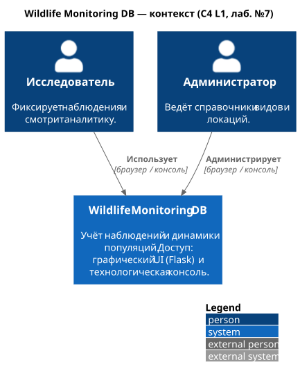

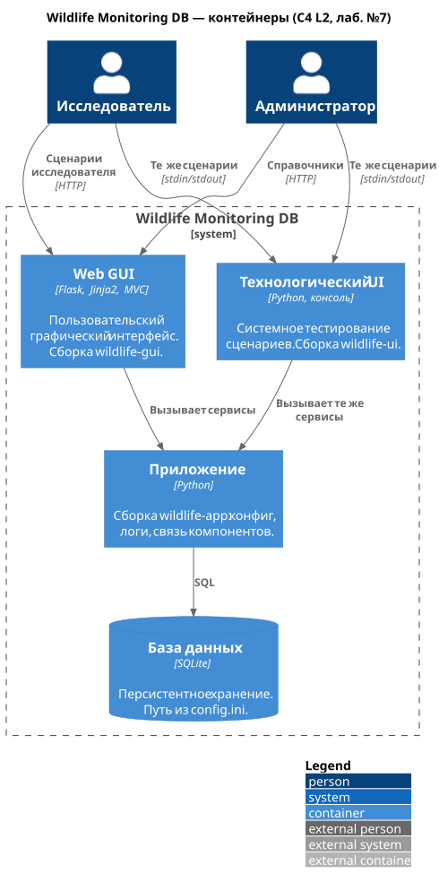

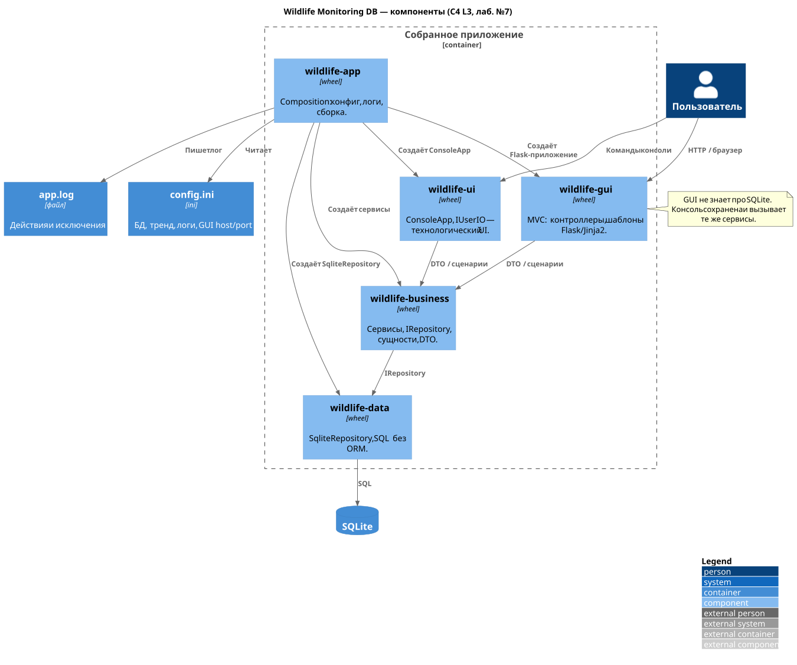

## 32. C4 L4 — диаграмма компонента GUI

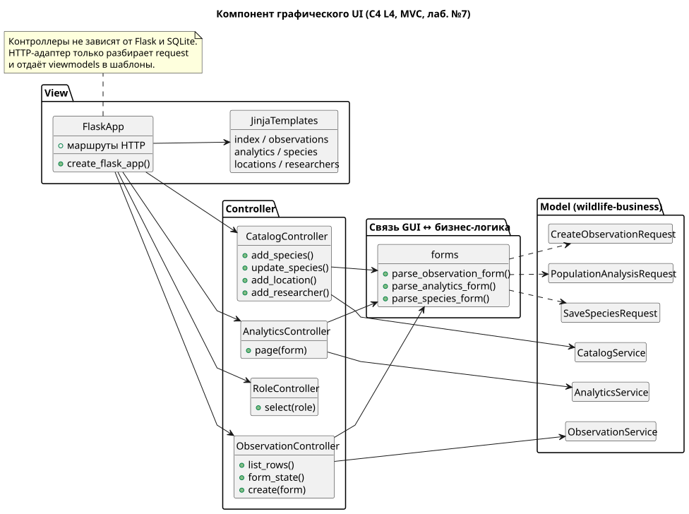

Исходники: [diagrams/lab7/c4/](diagrams/lab7/c4/), [diagrams/lab7/uml/class-gui-layer.puml](diagrams/lab7/uml/class-gui-layer.puml).

Пересборка: `.\diagrams\render-lab7.ps1`

---

# ТИОПО — Лабораторная работа №2: integration, E2E, CI/CD

## 33. Структура тестов и порядок этапов

| Этап | Каталог | Суффикс файлов | Что проверяет |
| --- | --- | --- | --- |
| 1. Unit | `tests/unit/` | `test_*.py` | тесты ЛР1 (классическая и лондонская школы) |
| 2. Integration | `tests/integration/` | `*_it.py` (Integration Test) | `CatalogService`/`ObservationService`/`AnalyticsService` + `SqliteRepository` на отдельном файловом инстансе SQLite |
| 3. E2E | `tests/e2e/` | `*_e2e.py` | демонстрационный сценарий MVP через HTTP API стенда в Docker (без GUI) |

Один файл — один тест; arrange в начале, затем шаги `act` / `assert` (шаги Allure).
Каждый тест получает метку этапа (`parentSuite` в Allure, маркер pytest `unit|integration|e2e`).

## 34. Тестовое хранилище

Отдельный инстанс поднимается последовательным запуском скриптов [db/sql](db/sql):

1. `01_schema.sql` — генерация таблиц;
2. `02_seed.sql` — тестовые данные (явные id, одинаковые при каждом запуске);
3. `90_rollback.sql` + `02_seed.sql` — откат к состоянию до прогона (одной транзакцией).

Управление — [db/dbctl.py](db/dbctl.py): `init | rollback | verify | fingerprint`.
`verify` проверяет `PRAGMA integrity_check`, `foreign_key_check` и совпадение отпечатка данных с эталоном,
построенным теми же скриптами.

* **integration**: на прогон создаётся уникальный файл в tmp; после **каждого** теста (в т.ч. упавшего) —
  принудительный `rollback` + `verify`. С `WILDLIFE_IT_DB=<путь>` используется постоянный инстанс:
  перед стартом он обязан быть эталонным.
* **e2e**: стенд (`docker/app.Dockerfile`) при старте делает `init`/`verify` хранилища в томе `/data`;
  после E2E (успешного или нет) `ci/stand.sh cleanup` завершает все сессии, откатывает и проверяет хранилище.

Брокера сообщений в проекте нет. Активные сессии есть у HTTP API (`SessionRegistry`): E2E закрывает
свои сессии и проверяет, что токены больше не действуют; `cleanup` стенда завершает все сессии (`DELETE /api/v1/sessions`).

## 35. Docker и стенд

* [docker/tests.Dockerfile](docker/tests.Dockerfile) — контейнер запуска тестов: **выкачивает репозиторий**
  (`REPO_URL`, `GIT_REF`), ставит зависимости, точка входа [ci/run-tests.sh](ci/run-tests.sh) `<этап>`.
* [docker/app.Dockerfile](docker/app.Dockerfile) — тестируемая система (Flask GUI + JSON API `/api/v1`).
* [docker-compose.test.yml](docker-compose.test.yml) — стенд, контейнер тестов, `tcpdump` и `curl`-имитация.
* [ci/stand.sh](ci/stand.sh) — `up | e2e | cleanup | replay | down | all`.

Локально (Git Bash + Docker Desktop), полный аналог CI:

```bash
bash ci/local-pipeline.sh
```

Без Docker — unit + integration:

```bash
py -m pytest
```

**Параллельные разработчики.** Integration-хранилище — свой файл на каждый запуск. Стенд — свой
compose-проект (`STAND` с именем пользователя, временем и случайным числом): своя сеть, том и
контейнеры, порт хоста выбирается случайно. E2E-данные помечаются уникальным `run_tag`, поэтому даже
на общем стенде прогоны не пересекаются.

**Повторный запуск.** `ci/run-tests.sh integration` после основного прогона ещё дважды запускает
integration-тесты на одном постоянном инстансе и сравнивает результаты (JUnit XML).

## 36. CI/CD (GitHub Actions) и отчёт Allure

Пайплайн [.github/workflows/tests.yml](.github/workflows/tests.yml):

```
unit ──► integration ──► e2e
  └──────────┴────────────┴──► report (if: always())
```

* каждый этап — отдельный job в тестовом контейнере, следующий стартует только после успеха предыдущего (`needs`);
* `report` выполняется всегда: этапы без результатов прогоняются с `WILDLIFE_STAGE_SKIPPED` и попадают в
  отчёт как **skipped** (категория «Этап не запускался»);
* история (`history/`) берётся из ветки `gh-pages` → в отчёте есть **тренды** между запусками;
* отчёт публикуется в ветку **`gh-pages`**: `index.html` (GitHub Pages) и `allure-report.html` —
  один самодостаточный файл, который открывается без Allure и без сервера; он же лежит в артефакте `allure-report`.

Однократная настройка репозитория на GitHub: сделать репозиторий публичным,
**Settings → Pages → Deploy from a branch → `gh-pages` / root**. Отчёт:
`https://<owner>.github.io/<repo>/`.

## 37. Имитация E2E запросами и захват трафика

* [e2e/curl/replay.sh](e2e/curl/replay.sh) — тот же сценарий через `curl`;
* [e2e/postman/wildlife-e2e.postman_collection.json](e2e/postman/wildlife-e2e.postman_collection.json) — коллекция Postman (Run collection, `baseUrl` = адрес стенда).

В CI шаг «Имитация E2E через curl + захват трафика» запускает `tcpdump` в сетевом namespace
контейнера приложения и `curl`-сценарий; `curl-replay.pcap` (открывается в Wireshark, фильтр `http`)
и `curl-replay.log` — в артефакте `traffic`. Локально: `ci/stand.sh up`, затем `STAND=<имя> bash ci/stand.sh replay`,
либо Postman + Wireshark на loopback с фильтром `tcp.port == <порт стенда>`.

# ТИОПО — Лабораторная работа №3: микробенчмаркинг

## 38. Что сравнивается

**SQL против ORM** на слое данных проекта (вариант 5 задания). Обе реализации работают с одной и той же
схемой SQLite, через один и тот же драйвер `sqlite3`, с одинаковой валидацией входа и возвращают одни и те же
доменные объекты:

| | SQL | ORM |
| --- | --- | --- |
| Реализация | [`SqliteRepository`](src/wildlife_data/sqlite_repository.py) — существующий репозиторий, SQL руками | [`OrmRepository`](bench/orm_repository.py) — SQLAlchemy 2.0, декларативные модели тех же таблиц |
| Соединение | одно на поток, переиспользуется | пул движка, сессия (unit of work) на операцию |

Перед замерами `python -m bench verify` прогоняет один и тот же план операций на обеих реализациях и
сравнивает результаты каждой операции и итоговое состояние БД: сравнение честное, реализации делают одно и то же.

Сценарии ([bench/scenarios.py](bench/scenarios.py)), у обеих реализаций один и тот же план (id, даты, значения, порядок):

| Сценарий | Операция | Что нагружает |
| --- | --- | --- |
| `read_by_id` | `get_species(id)` | чтение по первичному ключу |
| `read_range` | `find_population_records(вид, 30 дней, локация)` | чтение диапазона по составному индексу, до 30 строк |
| `write_insert` | `add_observation(...)` + commit | запись |
| `mixed` | 70 % `find_population_records` + 30 % `upsert_population_record` | запись во время чтения в ту же таблицу и тот же индекс |

Исходная БД на каждый прогон создаётся заново и одинаково ([bench/dataset.py](bench/dataset.py)):
200 видов, 20 локаций, 5 000 наблюдений, 182 500 учётов численности.

## 39. Инструмент бенчмаркинга

Собственный, по образцу google/benchmark: [bench/harness.py](bench/harness.py). Один прогон состоит из фаз:

```
setup ─► калибровка overhead ─► warmup ─► measure ─► teardown ─► cleanup
          (пустая операция)     (до        (только     (хвост,
                                стабилизации) она идёт   записывается,
                                            в статистику) но не считается)
```

* **замер каждой операции**: `t0 = perf_counter_ns(); op(arg); t1 = perf_counter_ns()`; функция и аргумент
  берутся из заранее построенного плана до первого вызова таймера;
* **warmup** идёт кусками по 500 операций, пока медианы двух соседних кусков не сойдутся в пределах 5 %
  (минимум 2 000, максимум 20 000 операций); **teardown** — 1 000 операций после замера: в начале и в конце
  прогона быстрые операции статистически искажаются, поэтому в статистику идёт только `measure`;
* **испытаний**: 20 000 замеров на прогон (минимум 100 проверяется в коде) × 5 прогонов на пару
  «реализация × сценарий» = 100 000 замеров на пару;
* **overhead инструмента** калибруется в каждом прогоне: тот же цикл замера с пустой функцией вместо операции;
  отдельно меряется пара вызовов таймера подряд.

Результат прогона — `results/bench/raw/<сценарий>__<реализация>__rNN.json.gz` с сырыми задержками и
отметками времени всех фаз, длительностями фаз, числом операций в каждой фазе и окружением.

## 40. Равные условия: отдельный контейнер на каждый прогон

[docker/bench.Dockerfile](docker/bench.Dockerfile) — один образ, одна конфигурация (Python 3.12.8,
зафиксированные версии зависимостей, `PYTHONHASHSEED=0`). [ci/bench.sh](ci/bench.sh) запускает **каждый**
прогон в новом контейнере из этого образа:

```bash
docker run --rm --cpuset-cpus=1 --cpus=1 --memory=1g --network=none \
    --tmpfs /bench-db:rw,size=512m wildlife-bench run --target sql --scenario read_by_id --repeat 0
```

* 1 ядро CPU (`--cpuset-cpus` + `--cpus=1`), привязка видна в результатах (`cpu_affinity`);
* БД — в tmpfs: диск не влияет, оба участника в одинаковых условиях;
* без сети, с ограничением памяти;
* порядок реализаций чередуется между повторами, чтобы дрейф машины не играл против одной из них.

```bash
bash ci/bench.sh            # build → verify → run → report
BENCH_REPEATS=10 bash ci/bench.sh run
bash ci/bench.sh report     # results/bench/report/index.html
```

В CI — [.github/workflows/bench.yml](.github/workflows/bench.yml) (push в `lab3` или вручную с числом повторов):
отчёт в артефакте `bench-report`, сырые данные — `bench-raw`.

## 41. Отчёт: только графики

`python -m bench report` ([bench/report.py](bench/report.py)) строит по сырым данным графики (PNG) и
`index.html`; таблиц в отчёте нет. По каждому сценарию:

| Требование | График |
| --- | --- |
| a. измеряемая величина во времени | `*_timeline` — задержка каждой операции, все фазы; warmup/teardown подсвечены, линия — скользящая медиана |
| b. распределение по перцентилям | `*_percentiles` — одна линия на реализацию, логарифмическая ось перцентилей (50 % → 99.99 %) |
| c. гистограмма | `*_histogram` — логарифмические корзины, доля операций |
| d. перцентили 0.5 / 0.75 / 0.9 / 0.95 / 0.99 | `*_pbars` — столбцы с подписанными значениями (+ `mixed_kinds` отдельно для чтений и записей) |
| e. время выполнения теста | `*_phases`, нижняя половина — длительность каждой фазы и общее время |
| f. число операций с детализацией warmup / teardown | `*_phases`, верхняя половина — операции по фазам |

Сводные графики: p50/p99 по сценариям, отношение ORM/SQL, overhead инструмента, стабильность между прогонами.

## 42. Результаты

Графики ниже — предварительный прогон: 5 повторов × 4 сценария × 2 реализации = 40 прогонов,
каждый в отдельном процессе, привязанном к одному ядру (`taskset`), с БД в tmpfs (WSL2, Python 3.14,
SQLite 3.46, SQLAlchemy 2.0.44). Полный отчёт: [docs/lab3/index.html](docs/lab3/index.html). Итоговый прогон в
контейнерах — `bash ci/bench.sh` или workflow `bench`; его отчёт заменяет содержимое `docs/lab3`.

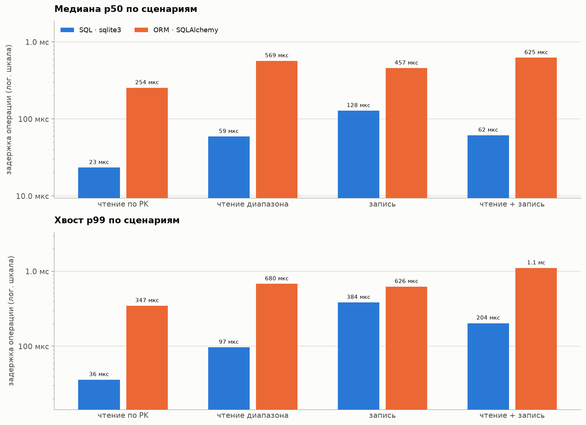

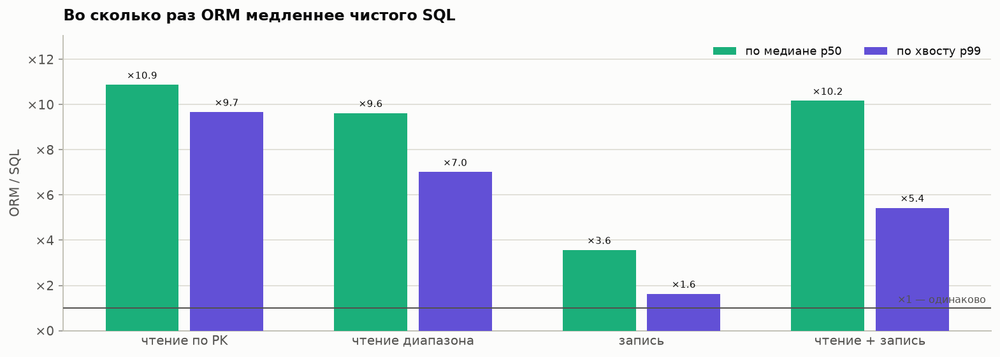

Пример полного набора графиков по сценарию — смешанное чтение + запись:

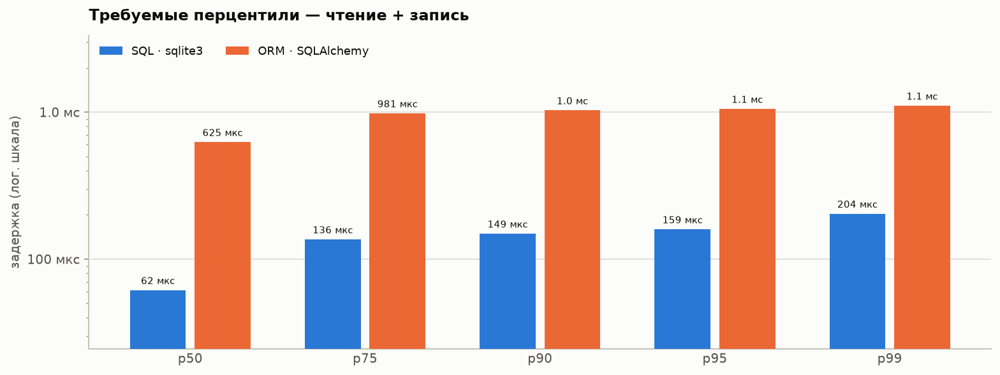
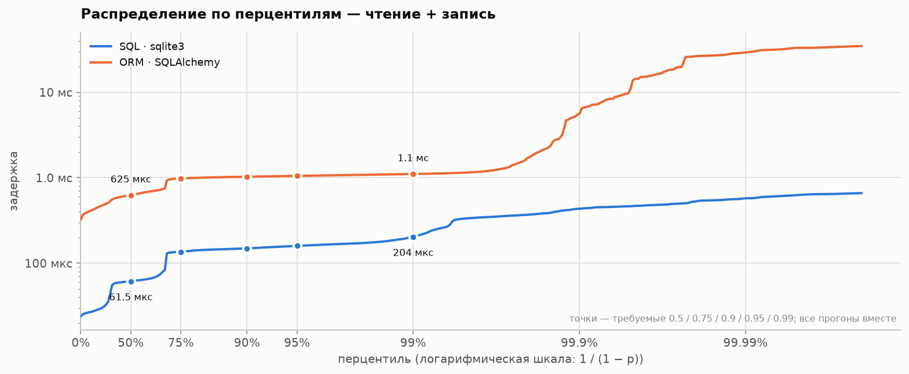
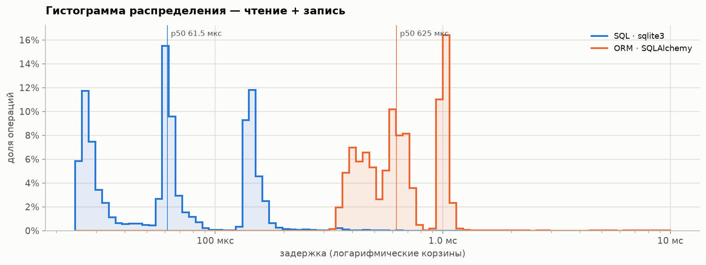
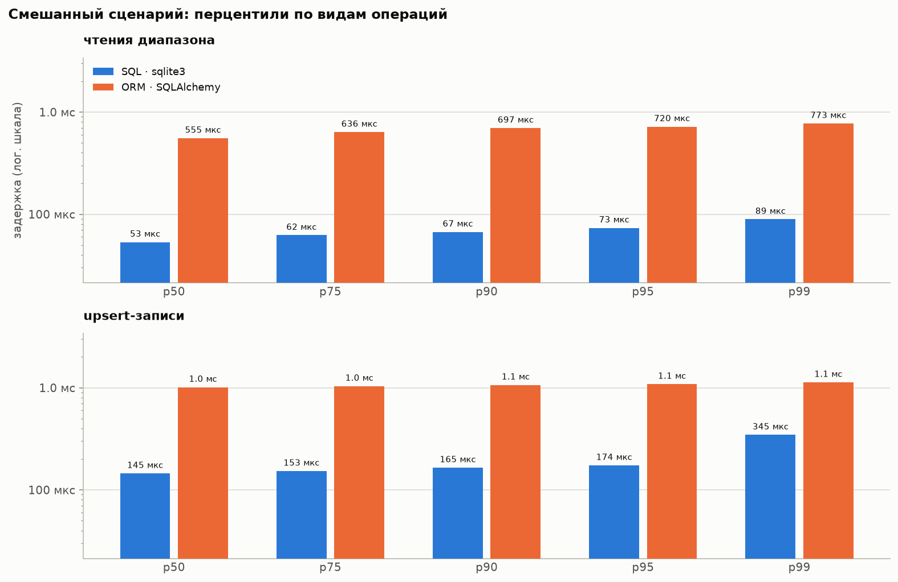
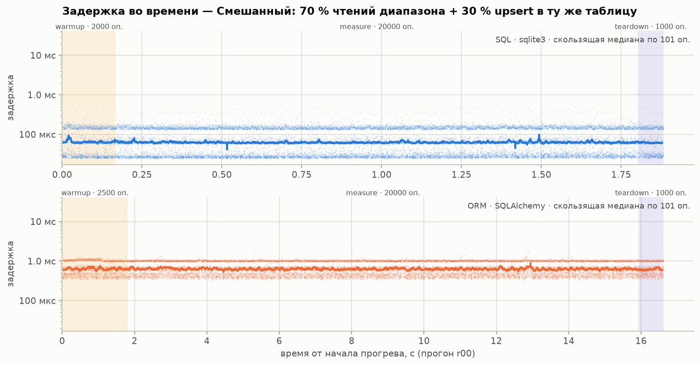
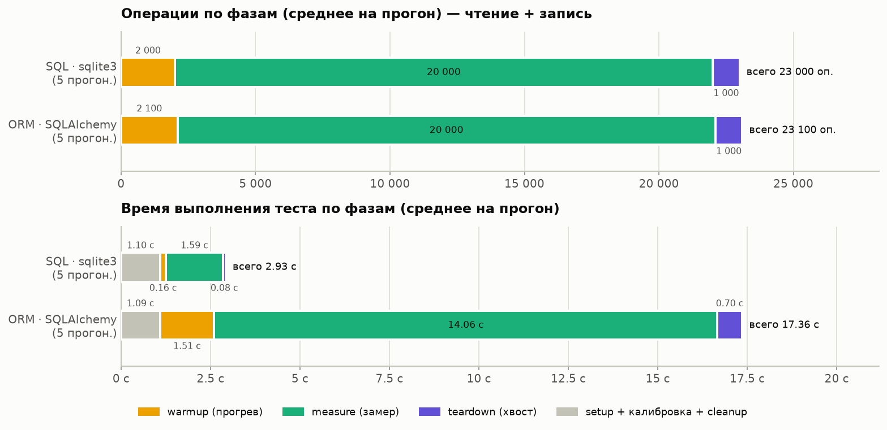

Overhead инструмента и стабильность между прогонами:

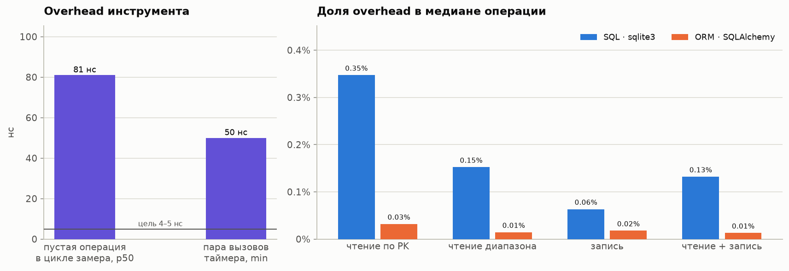
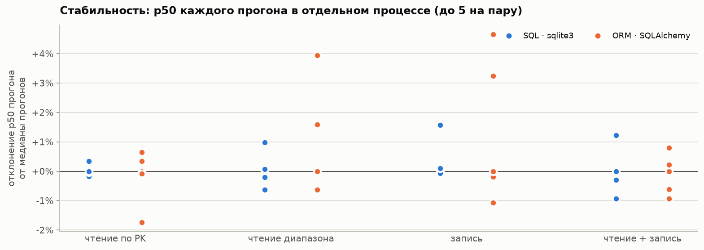

**Выводы**

* На чтении ORM медленнее примерно в 10 раз (чтение по PK: 23 мкс против 254 мкс по медиане). Сам запрос
  в SQLite занимает единицы микросекунд, остальное — накладные расходы ORM: сессия, компиляция `select`,
  identity map, создание объектов модели. Чем меньше работы делает БД, тем заметнее эта разница.
* На записи разрыв меньше (×3.6 по p50, ×1.6 по p99): commit и журнал SQLite стоят одинаково для обоих,
  поэтому доля накладных расходов ORM падает.
* В смешанном сценарии у SQL распределение трёхмодальное (пустые и заполненные окна чтения + upsert-ы,
  см. гистограмму), у ORM те же три моды сдвинуты вправо почти на порядок (0.4 / 0.6 / 1.0 мс); на p99 разница ×5.
* Прогрев короткий: медиана стабилизируется за 2 000–2 500 операций (на графике во времени нет «ступеньки»
  после warmup), хвост teardown тоже не отличается от замера. Различия между прогонами — в пределах ±2 %
  (±4 % у ORM), т. е. изоляция «новый процесс на прогон» даёт воспроизводимый результат.
* **Overhead инструмента** — 81 нс на замер (пустая операция в цикле), из них ~50 нс — сами вызовы
  `perf_counter_ns`. Цель 4–5 нс на CPython недостижима: один вызов функции интерпретатора дороже. Поэтому
  overhead измеряется в каждом прогоне и показан относительно операции: ≤ 0.35 % медианы в самом быстром
  сценарии, на результат сравнения не влияет.
