# Мониторинг популяции диких животных

## 1. Название проекта

**Wildlife Monitoring DB** — база данных для мониторинга популяции диких животных.

## 2. Краткое описание идеи проекта

Приложение предназначено для сбора, хранения и анализа данных о популяции диких животных в разных природных зонах. Оно позволяет фиксировать наблюдения за животными, учитывать места обитания и отслеживать изменения численности популяций во времени. Система будет полезна для исследователей и сотрудников природоохранных организаций, которым важно получать структурированные и актуальные данные.

## 3. Краткое описание предметной области

Предметная область — экологический мониторинг и учет популяции диких животных. Основные сущности предметной области: Животные или виды животных (Animals / Species), Наблюдения (Observations), Локации наблюдения (Locations), Исследователи (Researchers), а также Учеты численности (PopulationRecords). Система позволяет сохранять сведения о том, какие животные были замечены, где и когда это произошло, кем было выполнено наблюдение, а также анализировать динамику популяции по территориям и временным периодам.

## 4. Краткий анализ аналогичных решений


| Критерий                                 | Wildlife Insights                               | SMART Conservation Software                                    | Самописные таблицы / Excel                                      |
| ---------------------------------------- | ----------------------------------------------- | -------------------------------------------------------------- | --------------------------------------------------------------- |
| Структурированность и целостность данных | Высокая, данные организованы в рамках платформы | Высокая, поддерживается формализованная структура              | Низкая, высок риск дублей, пропусков и несогласованности данных |
| Гибкость настройки под локальные задачи  | Ограничена возможностями платформы              | Средняя, настройка возможна, но зависит от архитектуры системы | Формально высокая, но без контроля связей и ограничений         |
| Удобство анализа динамики популяции      | Высокое, доступны исследовательские инструменты | Высокое, возможно формирование отчетности и аналитики          | Низкое, анализ требует ручной обработки                         |
| Контроль качества вводимых данных        | Высокий, за счет правил платформы               | Высокий, благодаря централизованному управлению                | Низкий, ошибки ввода сложно предотвращать                       |


## 5. Краткое обоснование целесообразности и актуальности проекта

Мониторинг диких животных важен для оценки состояния экосистем, выявления угроз для отдельных видов и планирования природоохранных мероприятий. На практике данные часто собираются разрозненно, что затрудняет их анализ, сопоставление и долгосрочное хранение. Разработка специализированной базы данных позволит централизовать информацию о наблюдениях и популяциях, упростить работу исследователей и повысить качество экологического учета.

## 6. Краткое описание акторов (ролей)

- **Исследователь** – пользователь, который фиксирует наблюдения за животными, вносит информацию о месте, времени и результатах учета. Может просматривать историю собственных наблюдений и аналитические данные.
- **Администратор** – пользователь, который управляет справочниками видов и локаций, контролирует корректность данных, а также имеет доступ ко всем наблюдениям и отчетам в системе.


## 7. Use-Case диаграмма

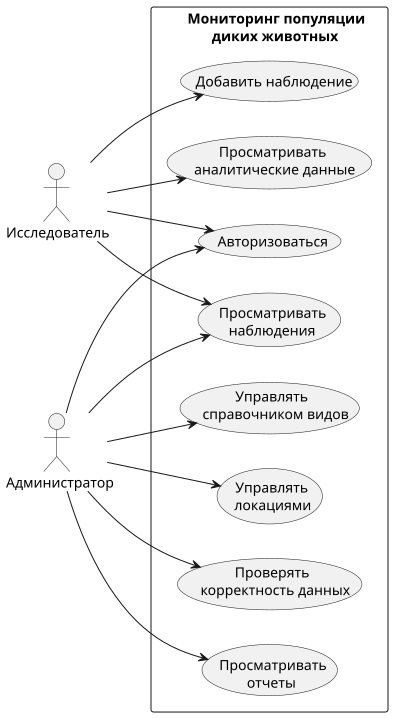

## 8. ER-диаграмма сущностей

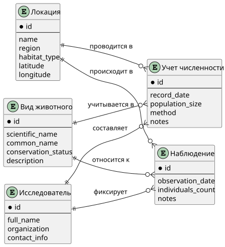

## 9. Пользовательские сценарии


### Сценарий 1 (актор: Исследователь)

1. Исследователь авторизуется в системе.
2. Переходит в раздел добавления нового наблюдения.
3. Выбирает вид животного, указывает локацию и дату наблюдения.
4. Вводит количество замеченных особей и дополнительные заметки.
5. Система сохраняет наблюдение в базе данных.


### Сценарий 2 (актор: Исследователь)

1. Исследователь открывает раздел статистики.
2. Выбирает интересующий вид животного.
3. Указывает временной диапазон и территорию наблюдения.
4. Система формирует выборку по сохраненным наблюдениям.
5. Исследователь получает данные о динамике численности популяции.


### Сценарий 3 (актор: Администратор)

1. Администратор авторизуется в системе.
2. Переходит в раздел управления справочником видов.
3. Добавляет новый вид животного или редактирует существующую запись.
4. При необходимости корректирует список локаций наблюдения.
5. Система обновляет справочные данные, которые затем доступны исследователям.


## 10. Формализация ключевых бизнес-процессов


### 10.1 Управление справочником видов

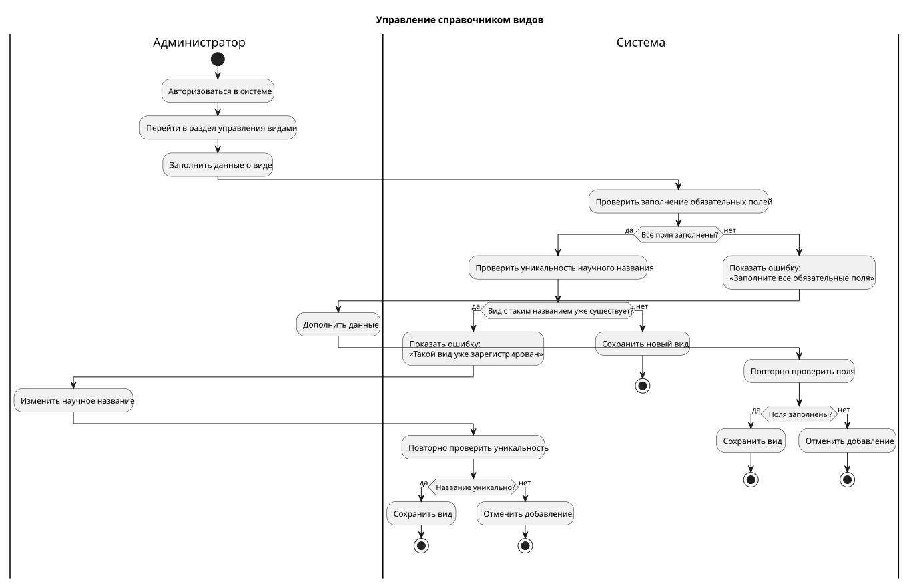

### 10.2 Фиксация учетных данных о популяции

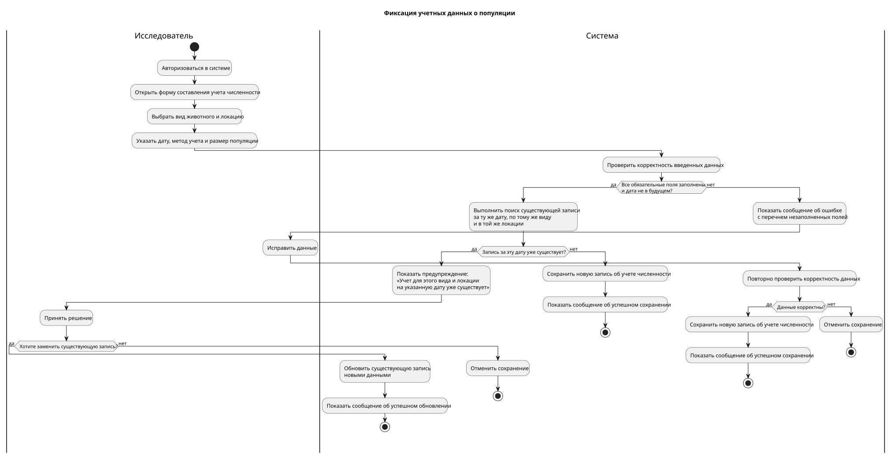

### 10.3 Анализ динамики популяции

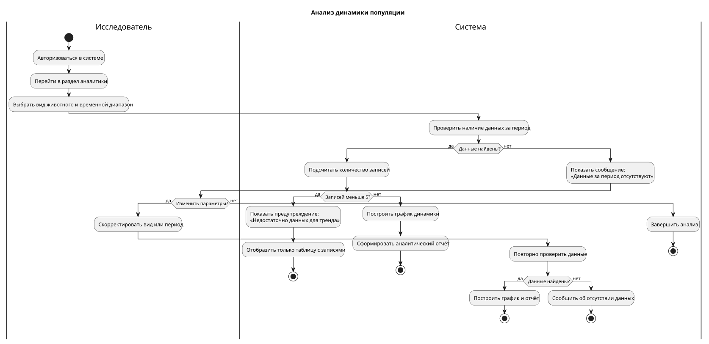

---


# Лабораторная работа №2 — UML и C4


## 11. Тип приложения и технологический стек


| Параметр                        | Выбор                                                                    |
| ------------------------------- | ------------------------------------------------------------------------ |
| Тип с точки зрения пользователя | **Web MPA** — многостраничное веб-приложение (формы и отчёты в браузере) |
| Язык                            | **Python 3.12**                                                          |
| UI (план)                       | **Flask** + **Jinja2** (MVC)                                             |
| Доступ к данным (план)          | **SQLAlchemy**, паттерн **Repository**                                   |
| СУБД                            | **PostgreSQL**                                                           |
| Принципы                        | Слои UI / сервисы / данные; **DIP** — сервисы зависят от `IRepository`   |


Уровень L4 на лаб. №2 раскрыт **диаграммами UML** (п. 15), без реализации слоя данных и UI.

Схема БД: [database/schema.dbml](./database/schema.dbml).

## 12. C4 — уровень L1 (контекст)

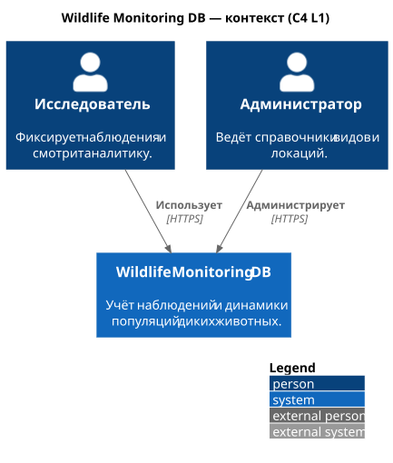

Исходник: [diagrams/lab2/c4/L1-context.puml](./diagrams/lab2/c4/L1-context.puml)

## 13. C4 — уровень L2 (контейнеры)

Для веб-приложения выделены три контейнера: **Web UI**, **Backend API**, **PostgreSQL**.

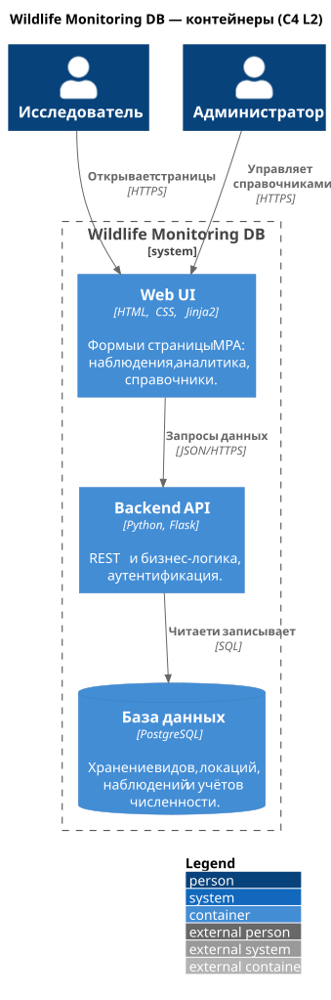

Исходник: [diagrams/lab2/c4/L2-container.puml](./diagrams/lab2/c4/L2-container.puml)

## 14. C4 — уровень L3 (компоненты)

Внутри Backend API: контроллеры (UI-слой API), сервисы (бизнес-логика), репозитории (доступ к данным). Web UI обращается только к API, не к БД напрямую.

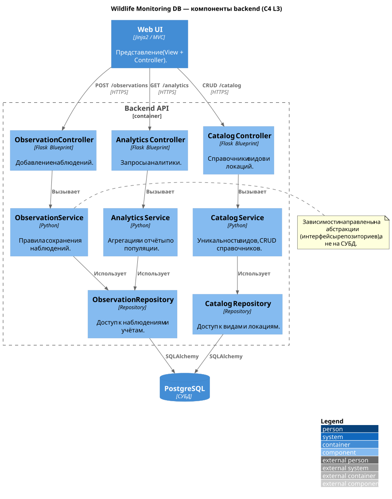

Исходник: [diagrams/lab2/c4/L3-component.puml](./diagrams/lab2/c4/L3-component.puml)

## 15. C4 — уровень L4 (UML диаграммы классов)


### 15.1 Компонент доступа к данным

ORM-модели, доменные сущности, интерфейс `IRepository` и `PostgresRepository`.

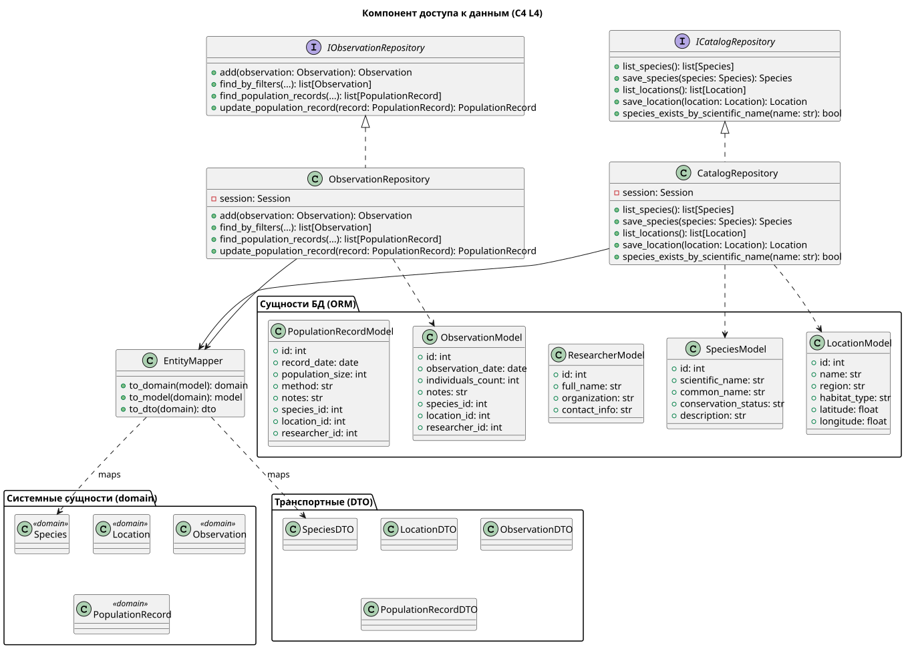

Исходник: [diagrams/lab2/uml/class-data-layer.puml](./diagrams/lab2/uml/class-data-layer.puml)

### 15.2 Компонент бизнес-логики

Сервисы работают с DTO и доменными объектами; зависят от абстракции `IRepository` (DIP). Черновик на момент лаб. №2:

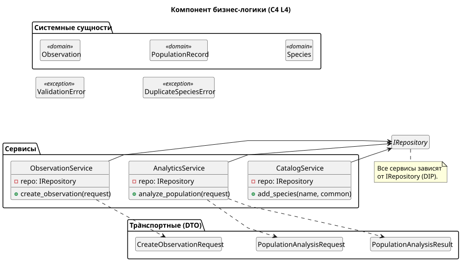

Исходник: [diagrams/lab2/uml/class-business-layer.puml](./diagrams/lab2/uml/class-business-layer.puml)

## 16. UML — диаграммы последовательностей (по BPMN из п. 10)


| BPMN (п. 10)                   | Диаграмма последовательности                                                     |
| ------------------------------ | -------------------------------------------------------------------------------- |
| 10.1 Добавление наблюдения     | [seq-add-observation.puml](./diagrams/lab2/uml/seq-add-observation.puml)         |
| 10.2 Анализ динамики популяции | [seq-population-analysis.puml](./diagrams/lab2/uml/seq-population-analysis.puml) |
| 10.3 Управление справочниками  | [seq-catalog-manage.puml](./diagrams/lab2/uml/seq-catalog-manage.puml)           |


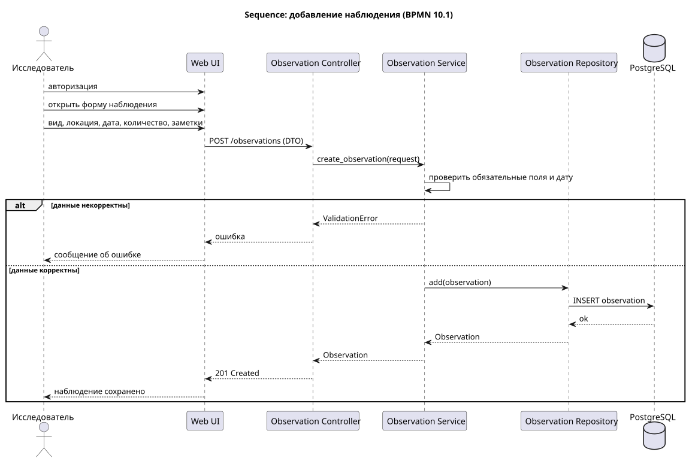

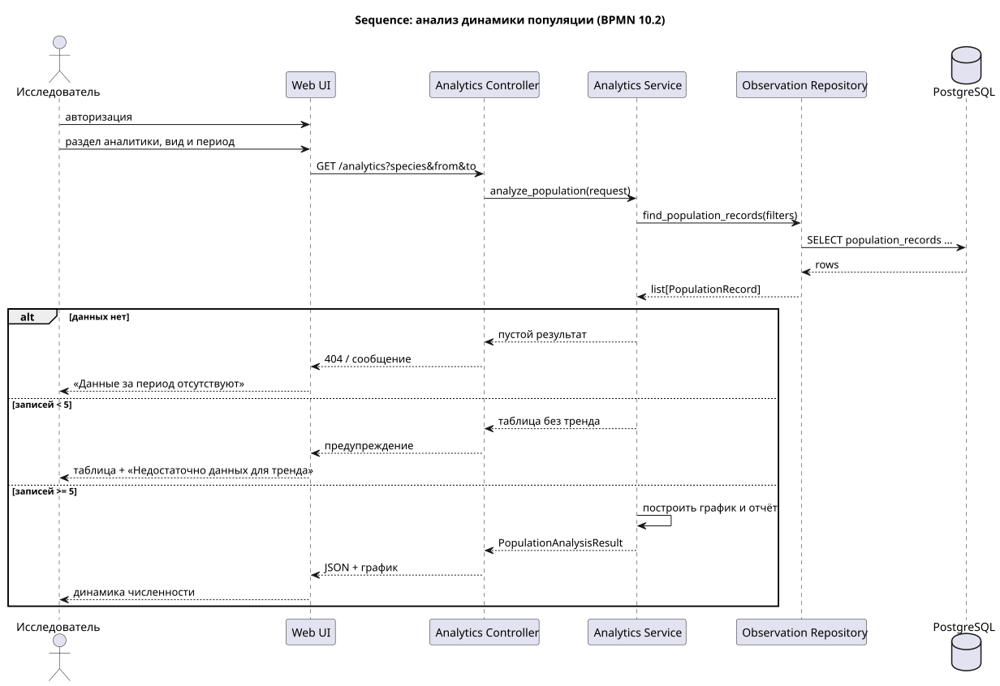

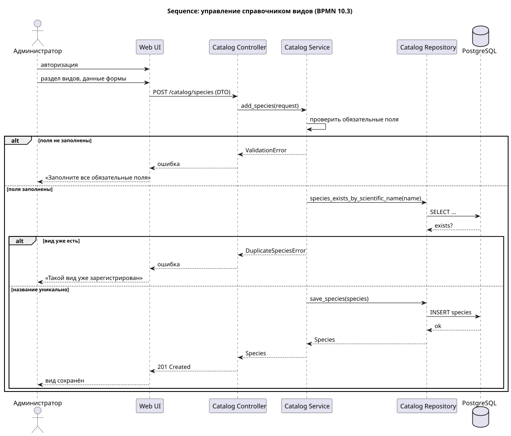

## 17. Схема базы данных (DBML, PostgreSQL)

Исходник: [database/schema.dbml](./database/schema.dbml)

Таблицы: `species`, `locations`, `researchers`, `observations`, `population_records` (связи — как в ER, п. 8). Уникальный ключ учёта численности: вид + локация + дата.

---


# Лабораторная работа №3 — бизнес-логика и тесты


## 18. Компонент бизнес-логики (реализация)

Код только для слоя бизнес-логики — каталог `[src/business/](src/business/)`:


| Модуль                   | Публичный API                                             |
| ------------------------ | --------------------------------------------------------- |
| `observation_service.py` | `create_observation(request)`                             |
| `analytics_service.py`   | `analyze_population(request)`                             |
| `catalog_service.py`     | `add_species(request)`                                    |
| `exceptions.py`          | `ValidationError`, `DuplicateSpeciesError`, `NoDataError` |


Вспомогательно для сервисов: `[src/entities.py](src/entities.py)`, `[src/dto.py](src/dto.py)`, интерфейс `[IRepository](src/repository.py)` (реализация — лаб. №4).

Сервисы зависят от `IRepository` (DIP). Правила по BPMN из п. 10.

Запуск unit-тестов (моки, без БД):

```bash
pip install -r requirements.txt
py -m pytest
```


## 19. C4 L4 — обновлённая диаграмма бизнес-логики (лаб. №3)

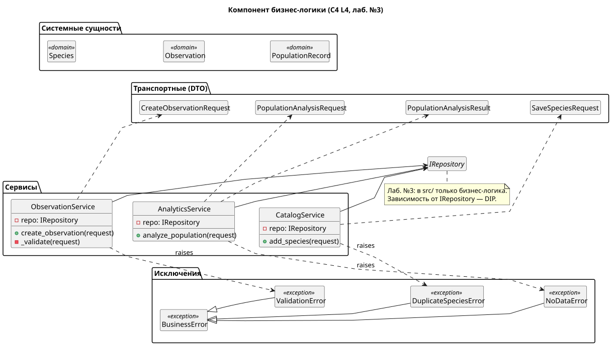

Исходник: [diagrams/lab3/uml/class-business-layer.puml](./diagrams/lab3/uml/class-business-layer.puml)

Пересборка SVG: `.\diagrams\render-lab3.ps1`

---


# Лабораторная работа №4 — доступ к данным


## 20. Компонент доступа к данным (реализация)

Код слоя данных — каталог `[src/repositories/](src/repositories/)`:


| Модуль                 | Назначение                                                                                                          |
| ---------------------- | ------------------------------------------------------------------------------------------------------------------- |
| `sqlite_repository.py` | `SqliteRepository` — SQL без ORM, файл SQLite                                                                       |
| `schema.py`            | DDL таблиц по [database/schema.dbml](database/schema.dbml)                                                          |
| `exceptions.py`        | `DataAccessError`, `DataValidationError`, `EntityNotFoundError`, `DuplicateEntityError`, `IntegrityConstraintError` |


Контракт задаёт бизнес-логика: `[IRepository](src/repository.py)` и доменные сущности `[src/entities.py](src/entities.py)`. Репозиторий **реализует** этот интерфейс (DIP): слой данных зависит от бизнес-слоя, а не наоборот. Конкретная СУБД за интерфейсом не видна — `SqliteRepository` можно заменить другой реализацией.

CRUD видов: `save_species`, `get_species`, `update_species`, `delete_species`. Также реализованы `add_observation`, `find_population_records`, `species_exists`.

Запуск тестов (unit бизнес-логики + интеграционные к SQLite):

```bash
pip install -r requirements.txt
py -m pytest
```


## 21. C4 L4 — обновлённая диаграмма доступа к данным (лаб. №4)

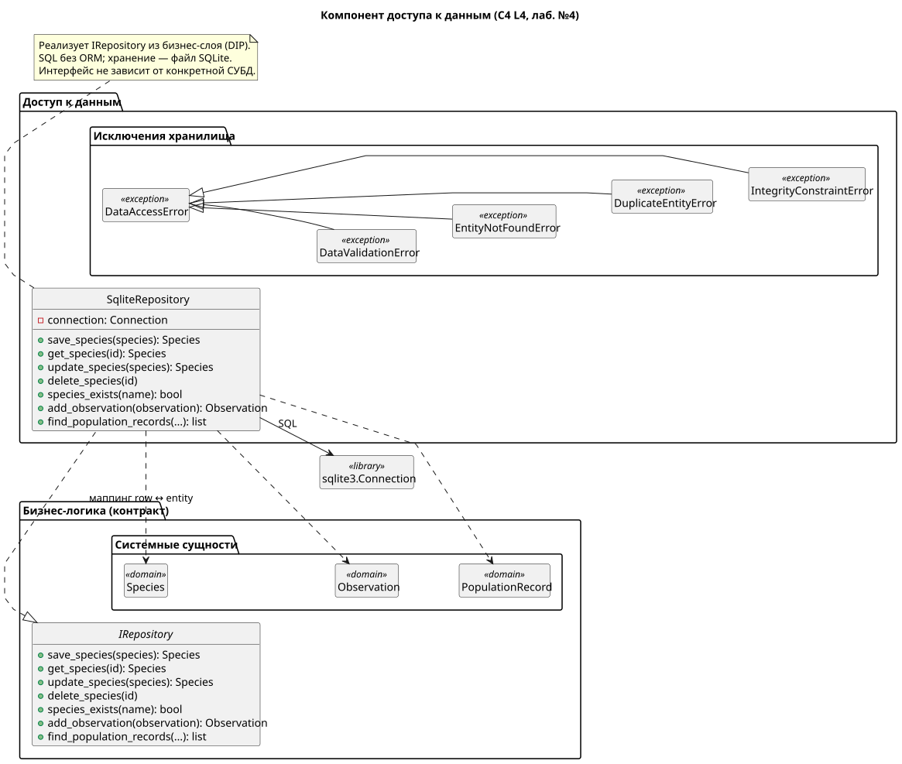

Исходник: [diagrams/lab4/uml/class-data-layer.puml](diagrams/lab4/uml/class-data-layer.puml)

Пересборка SVG: `.\diagrams\render-lab4.ps1`

---


# Лабораторная работа №5 — технологический UI


## 22. Технологический UI (реализация)

Консоль в `[src/wildlife_ui/](src/wildlife_ui/)` вызывает **те же сервисы**, что будет использовать будущий GUI (`ObservationService`, `CatalogService`, `AnalyticsService`). До SQLite UI не обращается: конкретный репозиторий собирается только в `[src/wildlife_app/main.py](src/wildlife_app/main.py)`.


| Модуль                       | Назначение                                          |
| ---------------------------- | --------------------------------------------------- |
| `wildlife_ui/console_app.py` | Меню ролей и сценарии из ТЗ                         |
| `wildlife_ui/io.py`          | `IUserIO` / `ConsoleIO` — ввод-вывод за интерфейсом |
| `wildlife_app/main.py`       | Composition root: SQLite + сервисы + консоль        |


Покрытие use case: выбор роли (авторизация-заглушка), добавить/смотреть наблюдения, аналитика популяции, справочник видов (добавить/изменить), локации, исследователи. Ошибки валидации показываются на экране.

Запуск:

```bash
py -m wildlife_app
```

Файл БД по умолчанию: `wildlife.db` (можно передать путь первым аргументом).

Системные тесты (консоль + сервисы + реальная SQLite, без моков):

```bash
py -m pytest tests/test_console_system.py
```


## 23. C4 L2 и L3 (обновление, лаб. №5)

Вместо запланированного Web UI на этом этапе — консольный технологический UI.

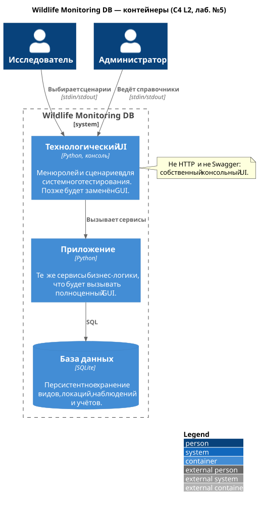

Исходник: [diagrams/lab5/c4/L2-container.puml](diagrams/lab5/c4/L2-container.puml)

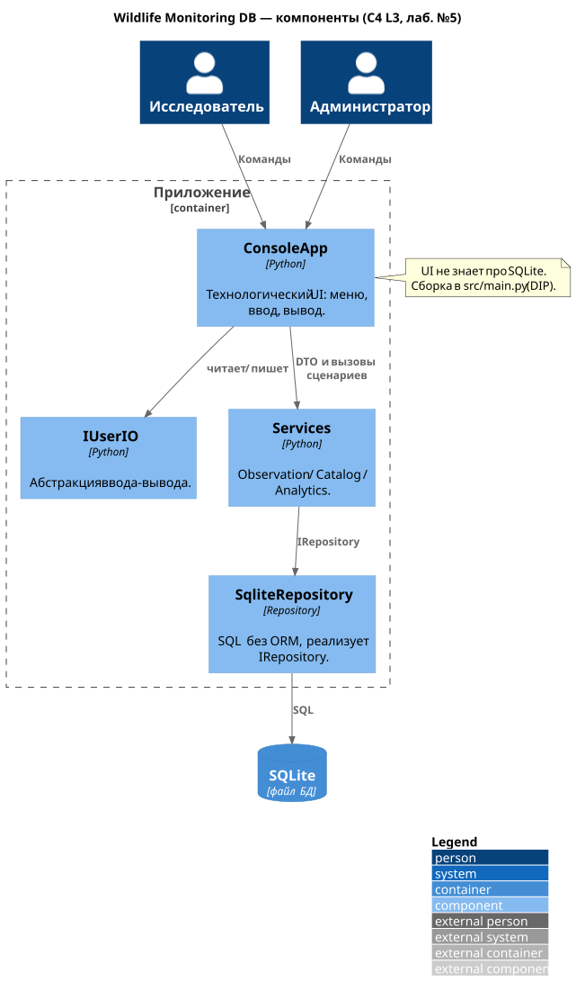

Исходник: [diagrams/lab5/c4/L3-component.puml](diagrams/lab5/c4/L3-component.puml)

## 24. C4 L4 — диаграмма технологического UI

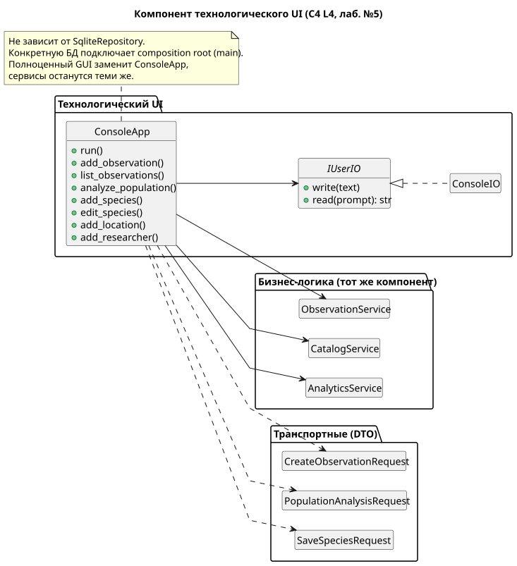

Исходник: [diagrams/lab5/uml/class-ui-layer.puml](diagrams/lab5/uml/class-ui-layer.puml)

Пересборка SVG: `.\diagrams\render-lab5.ps1`

---


# Лабораторная работа №6 — сборка, логирование, конфигурирование


## 25. Сборка компонентов

Каждый компонент — отдельная единица развёртывания:


| Сборка              | Исходники                                          | Назначение                                         |
| ------------------- | -------------------------------------------------- | -------------------------------------------------- |
| `wildlife-business` | `[src/wildlife_business/](src/wildlife_business/)` | Сервисы, `IRepository`, сущности, DTO              |
| `wildlife-data`     | `[src/wildlife_data/](src/wildlife_data/)`         | `SqliteRepository`, SQL без ORM                    |
| `wildlife-ui`       | `[src/wildlife_ui/](src/wildlife_ui/)`             | Технологический UI                                 |
| `wildlife-app`      | `[src/wildlife_app/](src/wildlife_app/)`           | Связывает три компонента, читает конфиг, пишет лог |


Описания сборок: `[components/](components/)`. Готовые файлы: `[assembled/](assembled/)`.

Собрать заново:

```bash
.\scripts\build_components.ps1
```


## 26. Конфигурация и логирование

Файл `[config.ini](config.ini)`:

- `database.connection_string` — строка подключения к SQLite
- `business.min_records_for_trend` — порог записей для тренда (бизнес-логика)
- `logging.level` / `logging.file` — уровень и файл лога

В лог пишутся действия пользователя (INFO) и все исключения (WARNING/ERROR с трассировкой): `logs/app.log`.

## 27. Запуск не из IDE

Двойной щелчок или из проводника/терминала:

```text
run.bat
```

Либо из папки собранных компонентов (ставится venv и колёса):

```text
assembled\run.bat
```


## 28. C4 L1–L4 (уточнение на всё приложение)

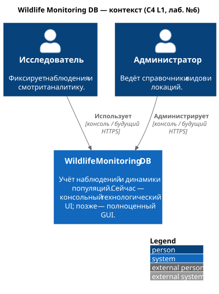

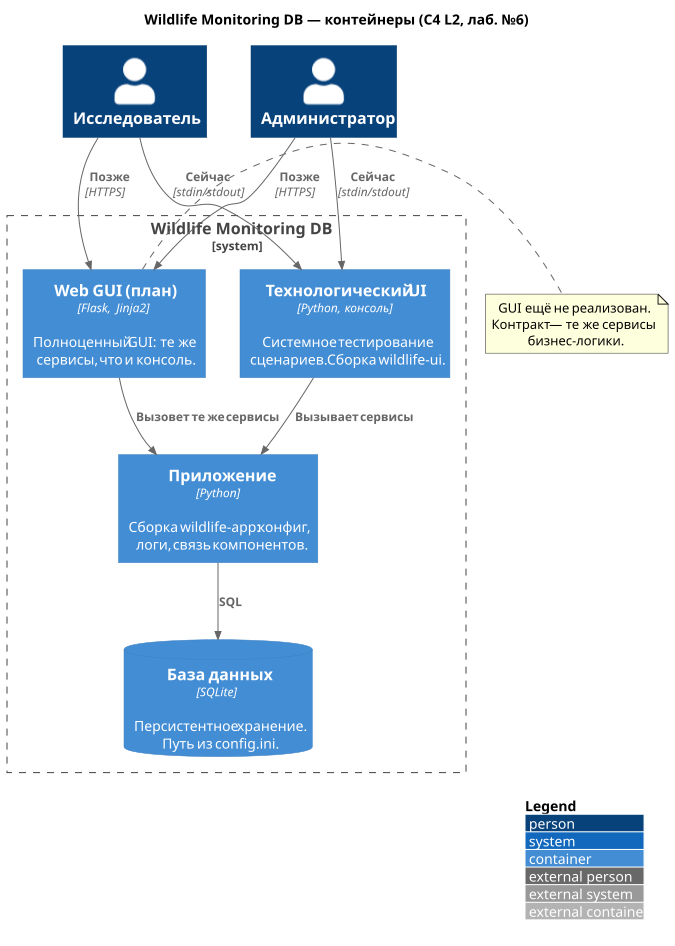

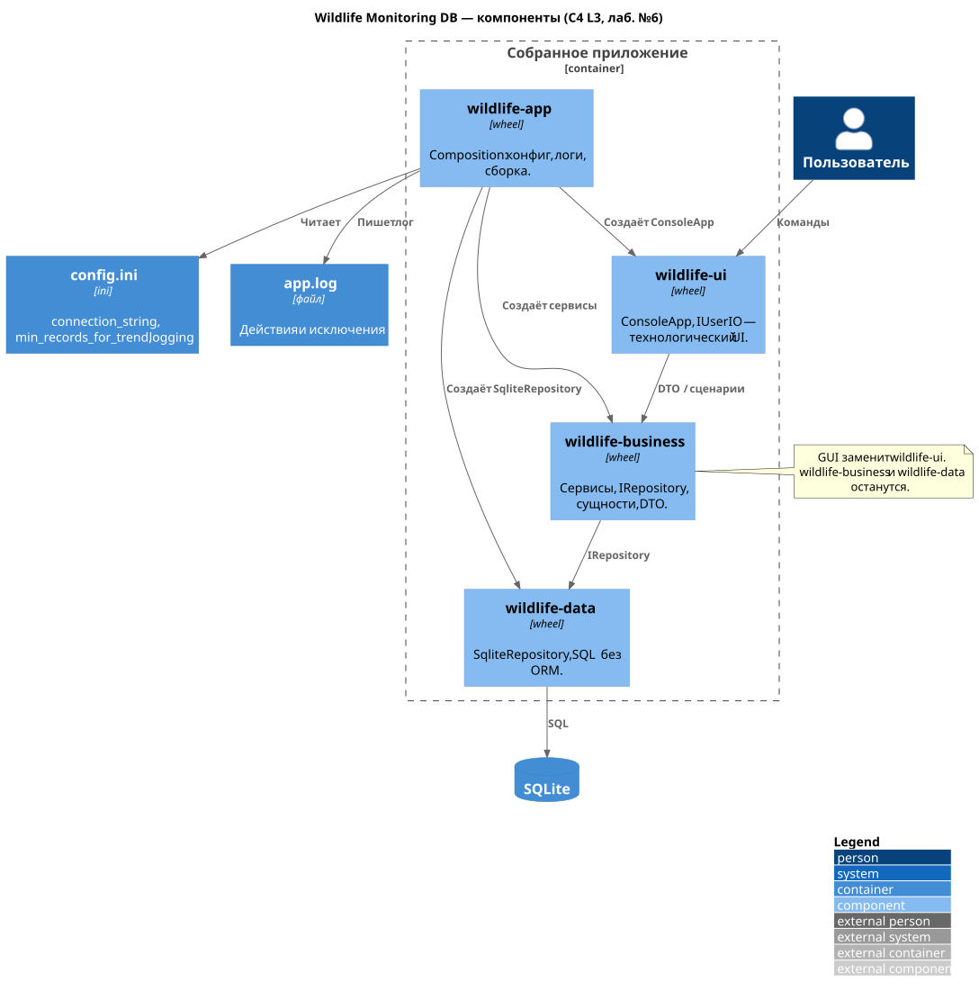

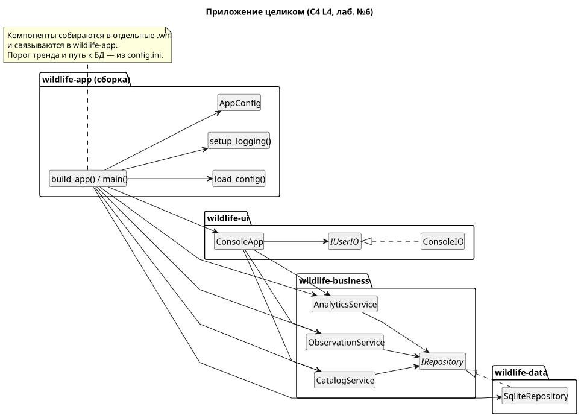

Исходники: [diagrams/lab6/c4/](diagrams/lab6/c4/), [diagrams/lab6/uml/class-application.puml](diagrams/lab6/uml/class-application.puml).

Пересборка: `.\diagrams\render-lab6.ps1`

## 29. Собранные компоненты (файлы сборок)

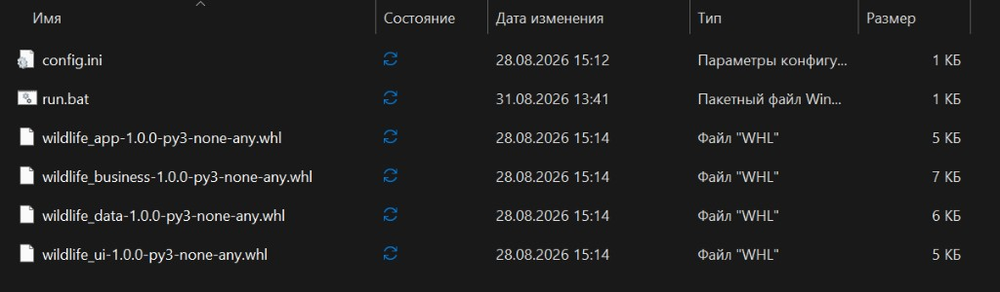

Папка: `[assembled/](assembled/)` — `.whl` компонентов, `config.ini`, `run.bat`.

---


# Лабораторная работа №7 — графический UI (MVC)


## 30. Компонент графического интерфейса

GUI — каталог `[src/wildlife_gui/](src/wildlife_gui/)`, сборка `wildlife-gui`. Паттерн **MVC**:


| Слой             | Код                                                              | Назначение                                            |
| ---------------- | ---------------------------------------------------------------- | ----------------------------------------------------- |
| Model            | сервисы `wildlife_business` и DTO                                | Те же сценарии, что и у консоли                       |
| Controller       | `[controllers.py](src/wildlife_gui/controllers.py)`              | Роли, viewmodel, обработка ошибок домена              |
| View             | шаблоны Jinja2 и `[flask_app.py](src/wildlife_gui/flask_app.py)` | HTTP: маршруты Flask, сессия роли, отрисовка          |
| Связь с бизнесом | `[forms.py](src/wildlife_gui/forms.py)`                          | Формы GUI → DTO; GUI не зависит от `SqliteRepository` |


Экраны разнесены: выбор роли; у исследователя — список наблюдений, добавление, аналитика; у администратора — виды, локации, исследователи. Текущие роль и раздел всегда видны в шапке, результат операции — сообщением на экране.

Технологический UI сохранён: `py -m wildlife_app` или `--ui console`. Графический UI:

```bash
py -m wildlife_app --ui gui
```

Либо `run-gui.bat`. Адрес по умолчанию: http://127.0.0.1:5000 (секция `[gui]` в `[config.ini](config.ini)`).

Пересборка колёс: `.\scripts\build_components.ps1` — в `[assembled/](assembled/)` появляется `wildlife_gui-*.whl`. Запуск GUI из сборок: `assembled\run-gui.bat`.

Тесты контроллеров и HTTP-потока:

```bash
py -m pytest tests/test_gui.py
```

## 31. C4 L1–L3 (обновление) и L4 GUI

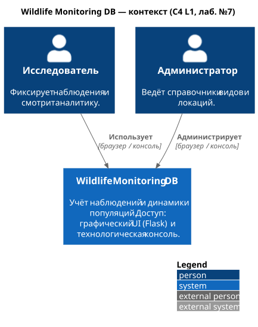

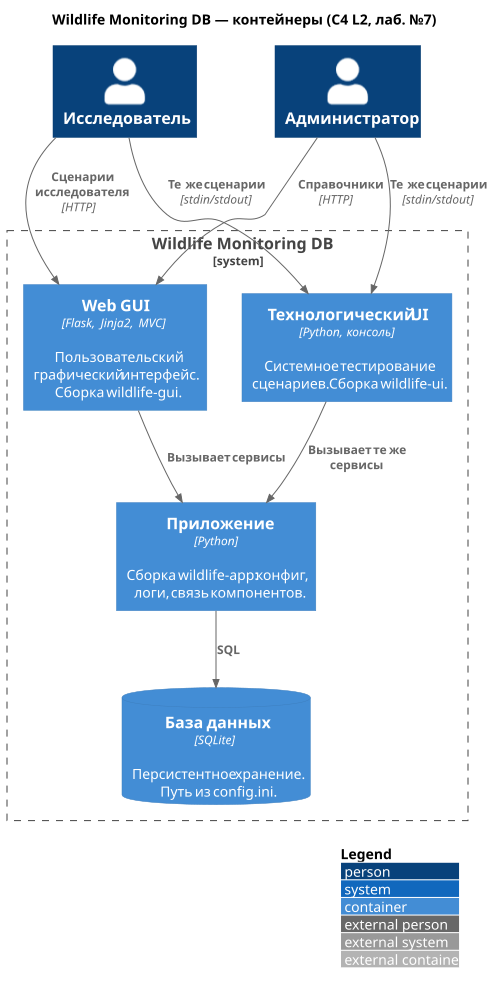

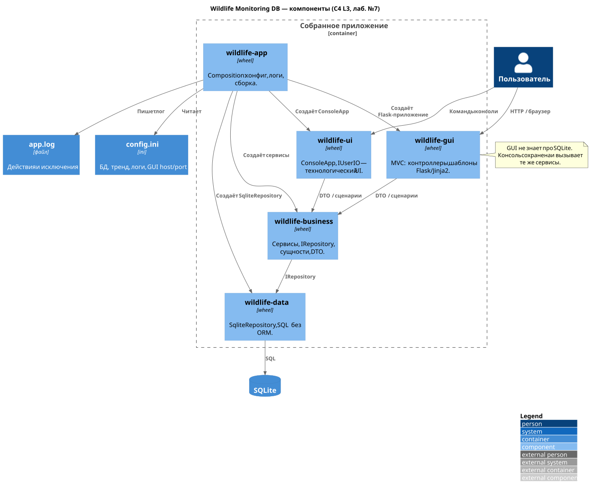

## 32. C4 L4 — диаграмма компонента GUI

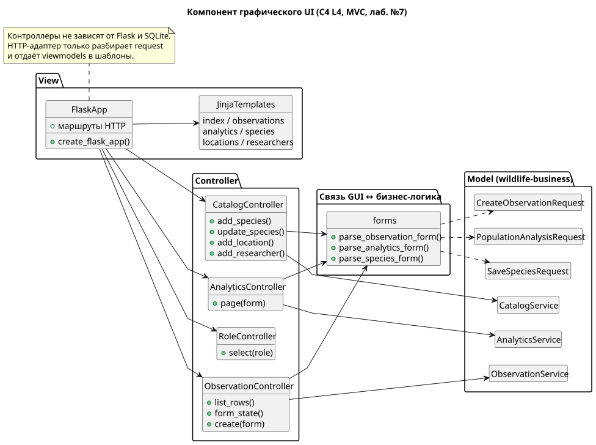

Исходники: [diagrams/lab7/c4/](diagrams/lab7/c4/), [diagrams/lab7/uml/class-gui-layer.puml](diagrams/lab7/uml/class-gui-layer.puml).

Пересборка: `.\diagrams\render-lab7.ps1`
